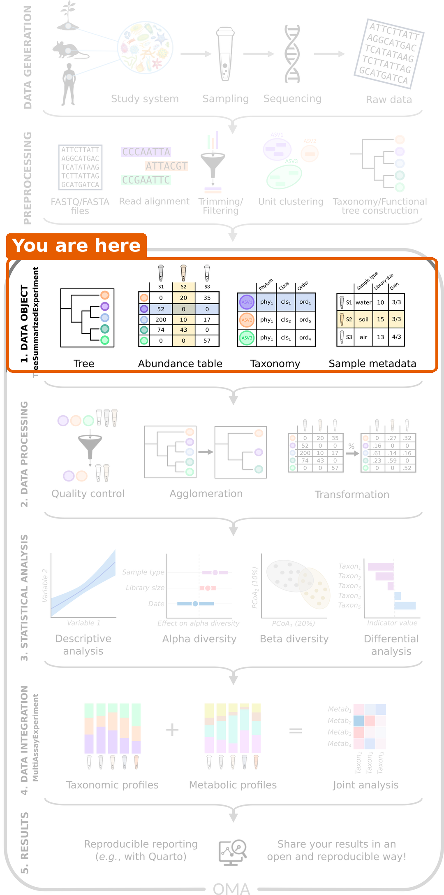
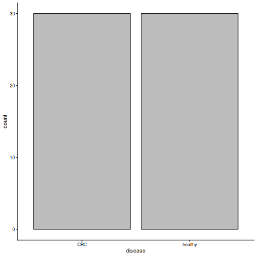
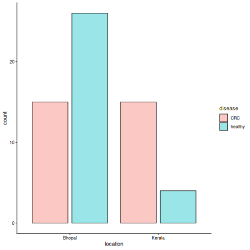

:::::::::::::::::::::::::::::::::::::: questions

- How do we load microbiome data into R?
- Why do we store the data in a single object?
- What is in our study data?

::::::::::::::::::::::::::::::::::::::::::::::::

::::::::::::::::::::::::::::::::::::: objectives

- Create a `TreeSummarizedExperiment` object from an abundance table, a taxonomy table, sample information and a tree.
- Access the abundance table, the taxonomy and the sample information of the object.
- Select a subset of the samples.
- Plot how many samples are in each study group.

::::::::::::::::::::::::::::::::::::::::::::::::


## Where are we?



The sequencing reads of our study have already been turned into tables. In
this episode, we bring these tables into R and combine them into a single
**data object**. All later steps start from this object.

## Load packages


``` r
library(mia)
library(miaViz)
```

## Read the data files

We start by reading the four files from [episode 3](03-setup.Rmd) into R.
The first column of each CSV file contains the row names, so we use
`row.names = 1`.


``` r
counts  <- read.csv(file.path("data", "taxonomy_abundance.csv"), row.names = 1)
taxa    <- read.csv(file.path("data", "taxonomy_table.csv"), row.names = 1)
samples <- read.csv(file.path("data", "sample_metadata.csv"), row.names = 1)
tree    <- ape::read.tree(file.path("data", "phylogeny.tree"))
```

Let's take a quick look at each of them. The abundance table has one row per
taxon and one column per sample. The row names start with the taxonomic rank
of the taxon, such as `species-`, and the column names are sample IDs:


``` r
dim(counts)
```

``` output
[1] 308  60
```

``` r
counts[1:3, 1:3]
```

``` output
                                      GupDM_A_11 GupDM_A_15 GupDM_A1
species-Escherichia_coli                 1632336    5666898  6814491
species-Alistipes_putredinis              964884          0   225222
species-Porphyromonas_asaccharolytica     463162          0    92810
```

The taxonomy table has one row per taxon:


``` r
head(taxa, n = 3)
```

``` output
                                      superkingdom         phylum
species-Escherichia_coli                  Bacteria Proteobacteria
species-Alistipes_putredinis              Bacteria   Bacteroidota
species-Porphyromonas_asaccharolytica     Bacteria   Bacteroidota
                                                    class            order
species-Escherichia_coli              Gammaproteobacteria Enterobacterales
species-Alistipes_putredinis                  Bacteroidia    Bacteroidales
species-Porphyromonas_asaccharolytica         Bacteroidia    Bacteroidales
                                                  family         genus
species-Escherichia_coli              Enterobacteriaceae   Escherichia
species-Alistipes_putredinis               Rikenellaceae     Alistipes
species-Porphyromonas_asaccharolytica Porphyromonadaceae Porphyromonas
                                                            species
species-Escherichia_coli                           Escherichia coli
species-Alistipes_putredinis                   Alistipes putredinis
species-Porphyromonas_asaccharolytica Porphyromonas asaccharolytica
```

The sample information has one row per sample:


``` r
samples[1:3, c("disease", "age", "gender", "location")]
```

``` output
           disease age gender location
GupDM_A_11     CRC  41 female   Kerala
GupDM_A_15     CRC  59   male   Kerala
GupDM_A1       CRC  62   male   Kerala
```

And the tree connects the taxa:


``` r
tree
```

``` output

Phylogenetic tree with 10430 tips and 10429 internal nodes.

Tip labels:
  k__Archaea|p__Candidatus_Micrarchaeota|c__Candidatus_Micrarchaeota_unclassified|o__Candidatus_Micrarchaeota_unclassified|f__Candidatus_Micrarchaeota_unclassified|g__Candidatus_Micrarchaeota_unclassified|s__Candidatus_Micrarchaeota_archaeon_CG1_02_55_22, k__Archaea|p__Archaea_unclassified|c__Archaea_unclassified|o__Archaea_unclassified|f__Archaea_unclassified|g__Archaea_unclassified|s__archaeon_GW2011_AR15, k__Archaea|p__Candidatus_Diapherotrites|c__Candidatus_Diapherotrites_unclassified|o__Candidatus_Diapherotrites_unclassified|f__Candidatus_Diapherotrites_unclassified|g__Candidatus_Diapherotrites_unclassified|s__Candidatus_Diapherotrites_archaeon_CG08_land_8_20_14_0_20_34_12, k__Archaea|p__Archaea_unclassified|c__Archaea_unclassified|o__Archaea_unclassified|f__Archaea_unclassified|g__Archaea_unclassified|s__archaeon_GW2011_AR10, k__Archaea|p__Candidatus_Diapherotrites|c__Candidatus_Diapherotrites_unclassified|o__Candidatus_Diapherotrites_unclassified|f__Candidatus_Diapherotrites_unclassified|g__Candidatus_Diapherotrites_unclassified|s__Candidatus_Diapherotrites_archaeon_CG11_big_fil_rev_8_21_14_0_20_37_9, k__Archaea|p__Euryarchaeota|c__Euryarchaeota_unclassified|o__Euryarchaeota_unclassified|f__Euryarchaeota_unclassified|g__Euryarchaeota_unclassified|s__Euryarchaeota_archaeon_TMED173, ...

Rooted; includes branch length(s).
```

The tree is a reference tree from MetaPhlAn, the tool that produced our
tables. It contains 10430 species, many more than the
308 in our data. That is fine: each of our taxa has a tip with
the same name in the tree, and this is how R knows which tip belongs to which
taxon. The printout shows the first few tip labels, which belong to species
that are not in our data.

## Why put everything into one object?

We now have four separate objects that describe the same data. This is risky:
if we remove a sample from the abundance table, we have to remember to remove
it from the sample information too. If we forget, the tables no longer match,
and our results will be wrong without any warning.

The solution is to store everything in a single object that keeps the parts
in sync. In Bioconductor, microbiome data is stored in a
**`TreeSummarizedExperiment`** (TreeSE for short).


*Figure: the TreeSummarizedExperiment class (Huang et al. 2021, F1000Research). Source: [OMA](https://bioconductor.org/books/release/OMA/).*

The figure shows all the parts a TreeSE can hold. In this lesson, we only need
these four:

| Part | Contains | In our data |
|---|---|---|
| `assays` | The abundance tables. **Rows are taxa, columns are samples.** | Read counts |
| `rowData` | Information about the rows (taxa) | Taxonomy |
| `colData` | Information about the columns (samples) | Disease, age, gender, location, ... |
| `rowTree` | A tree that connects the rows | Phylogenetic tree |

::::::::::::::::::::::::::::::::::::: callout

## TreeSE and SummarizedExperiment

If you have used the `SummarizedExperiment` class before, for example in the
[Introduction to data analysis with R and Bioconductor](https://carpentries-incubator.github.io/bioc-intro/)
lesson: a TreeSE is a `SummarizedExperiment` with extra room for trees.
Everything you know about `SummarizedExperiment` also works for TreeSE. The
only difference in our data is what the rows are: genes in that lesson, taxa
here. The functions `assay()`, `rowData()` and `colData()` and subsetting
with `[ , ]` work exactly as you learned there.

:::::::::::::::::::::::::::::::::::::::::::::::

## Create the TreeSE

We combine the four parts with the function `TreeSummarizedExperiment()`.
The abundance table must be a matrix, so we convert it with `as.matrix()`.
We also give the data a name with `mainExpName`. This becomes useful in
the bonus section of the next episode, where we store the data at several
taxonomic ranks in the same object.


``` r
tse <- TreeSummarizedExperiment(
    assays  = list(counts = as.matrix(counts)),
    rowData = taxa,
    colData = samples,
    rowTree = tree,
    mainExpName = "main"
)
tse
```

``` output
class: TreeSummarizedExperiment 
dim: 308 60 
metadata(0):
assays(1): counts
rownames(308): species-Escherichia_coli species-Alistipes_putredinis
  ... species-Campylobacter_ureolyticus
  species-Prevotella_sp._oral_taxon_376
rowData names(7): superkingdom phylum ... genus species
colnames(60): GupDM_A_11 GupDM_A_15 ... GupDM_JO GupDM_JP
colData names(27): study_name subject_id ... disease_stage
  disease_location
reducedDimNames(0):
mainExpName: main
altExpNames(0):
rowLinks: a LinkDataFrame (308 rows)
rowTree: 1 phylo tree(s) (10430 leaves)
colLinks: NULL
colTree: NULL
```

The printout summarizes the object:

- `dim`: 308 taxa (rows) and 60 samples (columns).
- `assays(1): counts`: one abundance table, named `counts`.
- `rowData names(7)`: the taxonomy columns.
- `colData names(27)`: the columns of sample information.
- `rowTree`: the phylogenetic tree.

## Look inside the TreeSE

Each part has its own *accessor function*.

The abundance table is accessed with `assay()`:


``` r
assay(tse, "counts")[1:3, 1:3]
```

``` output
                                      GupDM_A_11 GupDM_A_15 GupDM_A1
species-Escherichia_coli                 1632336    5666898  6814491
species-Alistipes_putredinis              964884          0   225222
species-Porphyromonas_asaccharolytica     463162          0    92810
```

The taxonomy is accessed with `rowData()`:


``` r
rowData(tse)
```

``` output
DataFrame with 308 rows and 7 columns
                                      superkingdom         phylum
                                       <character>    <character>
species-Escherichia_coli                  Bacteria Proteobacteria
species-Alistipes_putredinis              Bacteria   Bacteroidota
species-Porphyromonas_asaccharolytica     Bacteria   Bacteroidota
species-Bacteroides_uniformis             Bacteria   Bacteroidota
species-Prevotella_stercorea              Bacteria   Bacteroidota
...                                            ...            ...
species-Ruminococcus_obeum_CAG-39         Bacteria     Firmicutes
species-Streptococcus_lutetiensis         Bacteria     Firmicutes
species-Prevotella_timonensis             Bacteria   Bacteroidota
species-Campylobacter_ureolyticus         Bacteria Proteobacteria
species-Prevotella_sp._oral_taxon_376     Bacteria   Bacteroidota
                                                      class             order
                                                <character>       <character>
species-Escherichia_coli                Gammaproteobacteria  Enterobacterales
species-Alistipes_putredinis                    Bacteroidia     Bacteroidales
species-Porphyromonas_asaccharolytica           Bacteroidia     Bacteroidales
species-Bacteroides_uniformis                   Bacteroidia     Bacteroidales
species-Prevotella_stercorea                    Bacteroidia     Bacteroidales
...                                                     ...               ...
species-Ruminococcus_obeum_CAG-39                Clostridia     Eubacteriales
species-Streptococcus_lutetiensis                   Bacilli   Lactobacillales
species-Prevotella_timonensis                   Bacteroidia     Bacteroidales
species-Campylobacter_ureolyticus     Epsilonproteobacteria Campylobacterales
species-Prevotella_sp._oral_taxon_376           Bacteroidia     Bacteroidales
                                                  family         genus
                                             <character>   <character>
species-Escherichia_coli              Enterobacteriaceae   Escherichia
species-Alistipes_putredinis               Rikenellaceae     Alistipes
species-Porphyromonas_asaccharolytica Porphyromonadaceae Porphyromonas
species-Bacteroides_uniformis             Bacteroidaceae   Bacteroides
species-Prevotella_stercorea              Prevotellaceae    Prevotella
...                                                  ...           ...
species-Ruminococcus_obeum_CAG-39       Oscillospiraceae  Ruminococcus
species-Streptococcus_lutetiensis       Streptococcaceae Streptococcus
species-Prevotella_timonensis             Prevotellaceae    Prevotella
species-Campylobacter_ureolyticus     Campylobacteraceae Campylobacter
species-Prevotella_sp._oral_taxon_376     Prevotellaceae    Prevotella
                                                     species
                                                 <character>
species-Escherichia_coli                    Escherichia coli
species-Alistipes_putredinis            Alistipes putredinis
species-Porphyromonas_asaccharolytica Porphyromonas asacch..
species-Bacteroides_uniformis          Bacteroides uniformis
species-Prevotella_stercorea            Prevotella stercorea
...                                                      ...
species-Ruminococcus_obeum_CAG-39     Ruminococcus obeum C..
species-Streptococcus_lutetiensis     Streptococcus luteti..
species-Prevotella_timonensis          Prevotella timonensis
species-Campylobacter_ureolyticus     Campylobacter ureoly..
species-Prevotella_sp._oral_taxon_376 Prevotella sp. oral ..
```

The sample information is accessed with `colData()`:


``` r
colData(tse)
```

``` output
DataFrame with 60 rows and 27 columns
            study_name  subject_id   body_site antibiotics_current_use
           <character> <character> <character>             <character>
GupDM_A_11 GuptaA_2019   GupDM_A11       stool                      no
GupDM_A_15 GuptaA_2019   GupDM_A15       stool                      no
GupDM_A1   GuptaA_2019    GupDM_A1       stool                      no
GupDM_A10  GuptaA_2019   GupDM_A10       stool                      no
GupDM_A12  GuptaA_2019   GupDM_A12       stool                      no
...                ...         ...         ...                     ...
GupDM_JL   GuptaA_2019    GupDM_JL       stool                      no
GupDM_JM   GuptaA_2019    GupDM_JM       stool                      no
GupDM_JN   GuptaA_2019    GupDM_JN       stool                      no
GupDM_JO   GuptaA_2019    GupDM_JO       stool                      no
GupDM_JP   GuptaA_2019    GupDM_JP       stool                      no
           study_condition     disease       age age_category      gender
               <character> <character> <integer>  <character> <character>
GupDM_A_11             CRC         CRC        41        adult      female
GupDM_A_15             CRC         CRC        59        adult        male
GupDM_A1               CRC         CRC        62        adult        male
GupDM_A10              CRC         CRC        65        adult      female
GupDM_A12              CRC         CRC        65        adult        male
...                    ...         ...       ...          ...         ...
GupDM_JL               CRC         CRC        59        adult      female
GupDM_JM               CRC         CRC        60        adult        male
GupDM_JN               CRC         CRC        58        adult        male
GupDM_JO               CRC         CRC        71       senior        male
GupDM_JP               CRC         CRC        67       senior        male
               country    location non_westernized sequencing_platform
           <character> <character>     <character>         <character>
GupDM_A_11         IND      Kerala              no     IlluminaNextSeq
GupDM_A_15         IND      Kerala              no     IlluminaNextSeq
GupDM_A1           IND      Kerala              no     IlluminaNextSeq
GupDM_A10          IND      Kerala              no     IlluminaNextSeq
GupDM_A12          IND      Kerala              no     IlluminaNextSeq
...                ...         ...             ...                 ...
GupDM_JL           IND      Bhopal              no     IlluminaNextSeq
GupDM_JM           IND      Bhopal              no     IlluminaNextSeq
GupDM_JN           IND      Bhopal              no     IlluminaNextSeq
GupDM_JO           IND      Bhopal              no     IlluminaNextSeq
GupDM_JP           IND      Bhopal              no     IlluminaNextSeq
           DNA_extraction_kit      PMID number_reads number_bases
                  <character> <integer>    <integer>    <numeric>
GupDM_A_11             Qiagen  31719139      6227234    883347281
GupDM_A_15             Qiagen  31719139      9884266   1384530792
GupDM_A1               Qiagen  31719139     27687226   3808647004
GupDM_A10              Qiagen  31719139      8468208   1174245166
GupDM_A12              Qiagen  31719139      6988838    984235167
...                       ...       ...          ...          ...
GupDM_JL               Qiagen  31719139      9878044   1387793557
GupDM_JM               Qiagen  31719139     10328094   1435043694
GupDM_JN               Qiagen  31719139      9789278   1347588954
GupDM_JO               Qiagen  31719139     11274338   1501226163
GupDM_JP               Qiagen  31719139     10400668   1428270555
           minimum_read_length median_read_length NCBI_accession
                     <integer>          <integer>    <character>
GupDM_A_11                  60                151     SRR8865600
GupDM_A_15                  60                150     SRR8865596
GupDM_A1                    60                150     SRR8865598
GupDM_A10                   60                150     SRR8865599
GupDM_A12                   60                150     SRR8865601
...                        ...                ...            ...
GupDM_JL                    60                151     SRR8865572
GupDM_JM                    60                150     SRR8865575
GupDM_JN                    60                150     SRR8865574
GupDM_JO                    60                150     SRR8865581
GupDM_JP                    60                150     SRR8865580
                          curator       BMI disease_subtype         tnm
                      <character> <numeric>     <character> <character>
GupDM_A_11 Arianna_Bonetti;Paol..     19.22  adenocarcinoma      t2m0n0
GupDM_A_15 Arianna_Bonetti;Paol..     21.40  adenocarcinoma      t2n0m0
GupDM_A1   Arianna_Bonetti;Paol..     20.08  adenocarcinoma      t2n0m0
GupDM_A10  Arianna_Bonetti;Paol..     21.01  adenocarcinoma      t3n2m0
GupDM_A12  Arianna_Bonetti;Paol..     20.32  adenocarcinoma      t2n2m0
...                           ...       ...             ...         ...
GupDM_JL   Arianna_Bonetti;Paol..     20.34  adenocarcinoma      t4n1m0
GupDM_JM   Arianna_Bonetti;Paol..     18.33  adenocarcinoma      t2n0m0
GupDM_JN   Arianna_Bonetti;Paol..     19.92  adenocarcinoma      t2n0m0
GupDM_JO   Arianna_Bonetti;Paol..     20.03  adenocarcinoma      t4n1m0
GupDM_JP   Arianna_Bonetti;Paol..     17.69  adenocarcinoma      t3n2m0
                  fobt disease_stage disease_location
           <character>   <character>      <character>
GupDM_A_11         yes             I           rectum
GupDM_A_15         yes             I           rectum
GupDM_A1           yes             I           rectum
GupDM_A10          yes           III            colon
GupDM_A12          yes           III           rectum
...                ...           ...              ...
GupDM_JL           yes           III           rectum
GupDM_JM           yes             I           rectum
GupDM_JN           yes             I           rectum
GupDM_JO           yes           III    sigmoid_colon
GupDM_JP           yes           III           rectum
```

A single column of the sample information can be accessed with `$`, just as
in a data frame:


``` r
table(tse$disease)
```

``` output

    CRC healthy 
     30      30 
```

`rowData()` and `colData()` return a `DataFrame`, the Bioconductor version of
a data frame. It works like a `data.frame`, but prints only the first and
last rows. The tree is accessed with `rowTree(tse)`. We do not need to look
at it now: functions that use the tree, such as phylogenetic diversity in
[episode 6](06-alpha-diversity.Rmd), find it there on their own.

::::::::::::::::::::::::::::::::::::: challenge

## Challenge 1: Where is the information?

In which part of `tse` would you find the age of each person?

a) `assay(tse, "counts")`
b) `rowData(tse)`
c) `colData(tse)`
d) `rowTree(tse)`

:::::::::::::::::::::::: solution

c) `colData(tse)`. Age describes a sample (a person), and information about
samples is stored in `colData`. You can get the ages with `tse$age`.

:::::::::::::::::::::::::::::::::
::::::::::::::::::::::::::::::::::::::::::::::::

::::::::::::::::::::::::::::::::::::: challenge

## Challenge 2: Which phylum?

Find out which phylum the first taxon in `tse` belongs to.

*Hint: the taxonomy is in `rowData(tse)`, and its columns are named
`superkingdom`, `phylum`, `class`, ...*

:::::::::::::::::::::::: solution


``` r
rownames(tse)[1]
```

``` output
[1] "species-Escherichia_coli"
```

``` r
rowData(tse)$phylum[1]
```

``` output
[1] "Proteobacteria"
```

:::::::::::::::::::::::::::::::::
::::::::::::::::::::::::::::::::::::::::::::::::

## Select a subset of samples

A TreeSE can be subset with square brackets `[rows, columns]`, just like a
data frame. Rows are taxa and columns are samples. To keep only the samples
from people with CRC, we select the columns where `disease` is `"CRC"`:


``` r
tse_crc <- tse[, tse$disease == "CRC"]
tse_crc
```

``` output
class: TreeSummarizedExperiment 
dim: 308 30 
metadata(0):
assays(1): counts
rownames(308): species-Escherichia_coli species-Alistipes_putredinis
  ... species-Campylobacter_ureolyticus
  species-Prevotella_sp._oral_taxon_376
rowData names(7): superkingdom phylum ... genus species
colnames(30): GupDM_A_11 GupDM_A_15 ... GupDM_JO GupDM_JP
colData names(27): study_name subject_id ... disease_stage
  disease_location
reducedDimNames(0):
mainExpName: main
altExpNames(0):
rowLinks: a LinkDataFrame (308 rows)
rowTree: 1 phylo tree(s) (10430 leaves)
colLinks: NULL
colTree: NULL
```

**Result:** the new object has 30 samples. The abundance table
and the sample information were subset together, so they still match. This is
the main reason we use a TreeSE.

::::::::::::::::::::::::::::::::::::: challenge

## Challenge 3: Healthy people only

1. Create an object `tse_healthy` that contains only the samples from healthy
   people.
2. How many samples does it have?

:::::::::::::::::::::::: solution


``` r
tse_healthy <- tse[, tse$disease == "healthy"]
ncol(tse_healthy)
```

``` output
[1] 30
```

:::::::::::::::::::::::::::::::::
::::::::::::::::::::::::::::::::::::::::::::::::

## A first look at the study

Before any analysis, it is good to know who is in the study. The miaViz
function `plotBarplot()` counts the samples in each group of a `colData`
column (`col.var`):


``` r
plotBarplot(tse, col.var = "disease")
```



**Result:** the study has 30 people with CRC and
30 healthy people.

The people come from two places: the city of Bhopal and the state of Kerala.
With `fill.by`, we can colour the bars by a
second variable:


``` r
plotBarplot(tse, col.var = "location", fill.by = "disease")
```



::::::::::::::::::::::::::::::::::::: challenge

## Challenge 4: What do you notice?

Look at the plot above.

1. From which location do most of the healthy people come?
2. Suppose we find that the microbiome of CRC patients differs from that of
   healthy people. Why could this be a problem?

:::::::::::::::::::::::: solution

1. Most healthy people come from Bhopal, while the CRC patients come equally
   from both places. You can check the numbers with
   `table(tse$location, tse$disease)`.
2. Diet and lifestyle differ between the places, and they affect the gut
   microbiome. A difference between CRC and healthy people could therefore be
   partly a difference between the two places. We will take this into account in
   the episodes on beta diversity and differential abundance.

:::::::::::::::::::::::::::::::::
::::::::::::::::::::::::::::::::::::::::::::::::

## Save the object

We save the TreeSE so that we can load it again in the next episode, without
repeating the import steps.


``` r
saveRDS(tse, file.path("data", "tse.rds"))
```

::::::::::::::::::::::::::::::::::::: callout

## Importing your own data

In this lesson, we built the TreeSE from plain tables. Your own data probably
comes from a tool such as QIIME 2, MetaPhlAn or mothur, or is stored as a
phyloseq object. The mia package has functions that import these formats
directly into a TreeSE. See the
[Import chapter of OMA](https://bioconductor.org/books/release/OMA/pages/import.html).

:::::::::::::::::::::::::::::::::::::::::::::::

::::::::::::::::::::::::::::::::::::: keypoints

- A `TreeSummarizedExperiment` keeps the abundance table, taxonomy, sample information and tree together and in sync.
- Rows are taxa and columns are samples.
- `assay()`, `rowData()` and `colData()` access the abundance table, the taxonomy and the sample information.
- Subsetting with `[rows, columns]` keeps all parts of the object in sync.
- `plotBarplot()` gives a quick overview of the study groups. In our study, the groups differ in more than disease: most healthy people come from Bhopal.

::::::::::::::::::::::::::::::::::::::::::::::::
