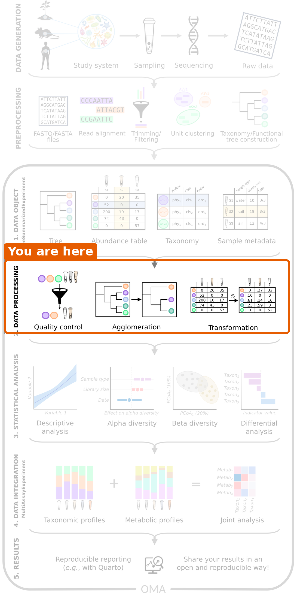
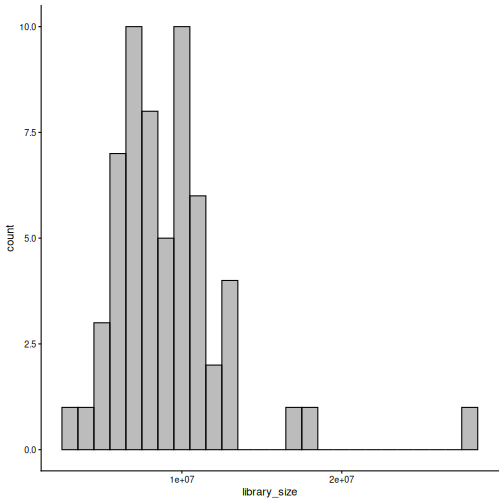
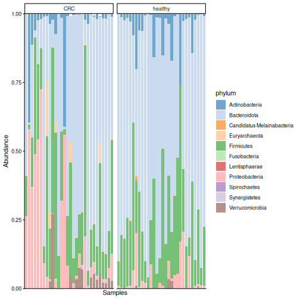
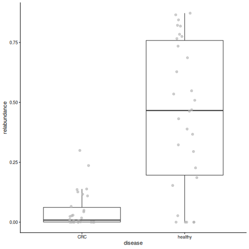
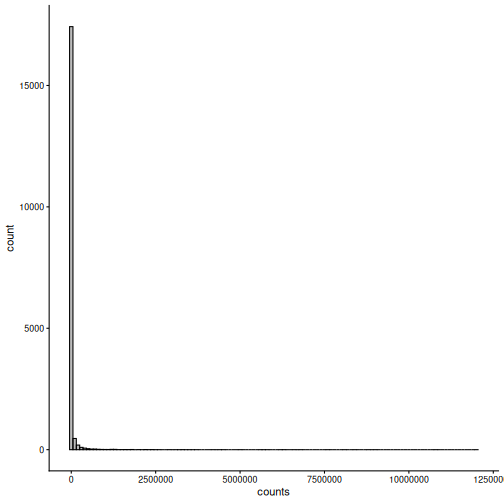
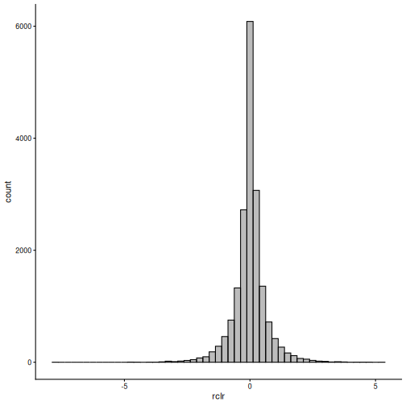
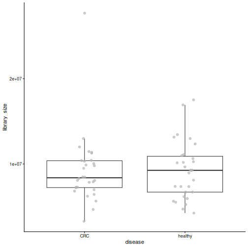
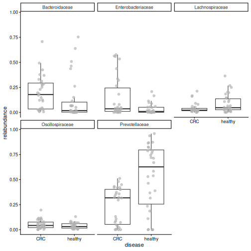

:::::::::::::::::::::::::::::::::::::: questions

- How deeply was each sample sequenced?
- How do we look at the data at a higher taxonomic level, such as phylum?
- Why and how do we transform the counts?
- Which bacteria dominate the gut of the people in our study?

::::::::::::::::::::::::::::::::::::::::::::::::

::::::::::::::::::::::::::::::::::::: objectives

- Plot the library sizes of the samples and explain why they matter.
- Agglomerate the data to a higher taxonomic rank.
- Transform counts into relative abundances and robust CLR (rclr) values, and explain what rclr does with the zeros.
- Plot the community composition of the samples and the abundance of a single taxon.
- Remove rare taxa with a prevalence filter.
- (Bonus) Store all taxonomic ranks in one object, and work with one rank using `altExp()` and `swapAltExp()`.

::::::::::::::::::::::::::::::::::::::::::::::::


## Where are we?



We have our data in a TreeSE. Before we can answer our research question, we
need to **process** the data: check its quality, summarize it and transform
it. We also take a first look at which bacteria are in the samples.

## Load packages and data


``` r
library(mia)
library(miaViz)
```

We load the TreeSE that we saved in the previous episode.


``` r
tse <- readRDS(file.path("data", "tse.rds"))
```

## Library size

In [episode 1](01-intro-microbiome.Rmd), we learned that the total number of
reads per sample, the **library size**, depends on the sequencing and not on
the biology. Let's check how much it varies. We sum the counts of each sample
(column) and store the result as a new column in `colData`:


``` r
tse$library_size <- colSums(assay(tse, "counts"))
summary(tse$library_size)
```

``` output
    Min.  1st Qu.   Median     Mean  3rd Qu.     Max. 
 3283981  6947241  8709694  9222329 10478061 27686725 
```

The miaViz function `plotHistogram()` shows the distribution. With
`binwidth`, we set the width of each bar, here one million reads:


``` r
plotHistogram(tse, col.var = "library_size", binwidth = 1e6)
```



**Result:** the largest sample has about
8 times more reads than
the smallest. If we compared raw counts, the samples with more reads would
seem to have more of everything. We fix this with a *transformation* below.

## Agglomeration: moving up the tree of life

Our data is at the **species** level. Sometimes it is easier to look at
bigger groups, such as genera or phyla. Combining all taxa that belong to the
same group is called **agglomeration**. The counts of the taxa in a group are
summed.


``` r
tse_phylum <- agglomerateByRank(tse, rank = "phylum")
rownames(tse_phylum)
```

``` output
 [1] "Actinobacteria"             "Bacteroidota"              
 [3] "Candidatus Melainabacteria" "Euryarchaeota"             
 [5] "Firmicutes"                 "Fusobacteria"              
 [7] "Lentisphaerae"              "Proteobacteria"            
 [9] "Spirochaetes"               "Synergistetes"             
[11] "Verrucomicrobia"           
```

**Result:** the 308 species belong to 11 phyla.

::::::::::::::::::::::::::::::::::::: challenge

## Challenge 1: How many genera?

1. Agglomerate the data to the genus level and save the result as
   `tse_genus`.
2. How many genera are in the data?

:::::::::::::::::::::::: solution


``` r
tse_genus <- agglomerateByRank(tse, rank = "genus")
nrow(tse_genus)
```

``` output
[1] 104
```

:::::::::::::::::::::::::::::::::
::::::::::::::::::::::::::::::::::::::::::::::::

## Relative abundance

To compare samples with different library sizes, we **transform** the counts.
The simplest transformation is the **relative abundance**: each count is
divided by the library size of its sample. The result is the *share* of each
taxon in the sample. For example, a taxon with 500 reads in a sample of 1000
reads has a relative abundance of 0.5 (50 %).

The function `transformAssay()` adds a transformed table to the TreeSE:


``` r
tse <- transformAssay(tse, assay.type = "counts", method = "relabundance")
assayNames(tse)
```

``` output
[1] "counts"       "relabundance"
```

The TreeSE now holds two tables: the original `counts` and the new
`relabundance` table. The original counts are kept.

::::::::::::::::::::::::::::::::::::: challenge

## Challenge 2: Relative abundances

1. What do you expect the relative abundances of each sample (column) to sum
   to?
2. Check your answer for the first five samples.

*Hint: `colSums()` sums the columns of a table.*

:::::::::::::::::::::::: solution

1. They sum to 1, because each value is the share of one taxon in the sample.
2. Check with `colSums()`:


``` r
colSums(assay(tse, "relabundance"))[1:5]
```

``` output
GupDM_A_11 GupDM_A_15   GupDM_A1  GupDM_A10  GupDM_A12 
         1          1          1          1          1 
```

:::::::::::::::::::::::::::::::::
::::::::::::::::::::::::::::::::::::::::::::::::

## Community composition

Which bacteria dominate the gut of the people in our study? The miaViz
function `plotAbundance()` draws a stacked bar for each sample. With
`group = "phylum"`, the taxa are agglomerated to phyla for the plot, and
`col.var = "disease"` together with `facet.cols = TRUE` splits the samples
into one panel per disease group. `scales = "free_x"` lets each panel show
only its own samples.


``` r
plotAbundance(
    tse, assay.type = "relabundance", group = "phylum",
    col.var = "disease", facet.cols = TRUE, scales = "free_x"
)
```

``` warning
Warning: Removed 355 rows containing missing values or values outside the scale range
(`geom_bar()`).
```



**Result:** each bar is one person. Bacteroidota dominate most samples in both
groups, followed by Firmicutes, but the communities vary a lot between people.
Our eyes cannot tell from this plot whether the two groups differ. The
analyses in the next episodes can.

::::::::::::::::::::::::::::::::::::: instructor

`plotAbundance()` may print a warning such as
`Removed 355 rows containing missing values`. It is harmless: the plot does
not draw bars for taxa with zero abundance.

::::::::::::::::::::::::::::::::::::::::::::::::

::::::::::::::::::::::::::::::::::::: challenge

## Challenge 3: The most abundant genera

Which five genera are the most abundant in the data?

*Hint: use `tse_genus` from challenge 1 and the function `getTop()`.*

:::::::::::::::::::::::: solution


``` r
getTop(tse_genus, top = 5)
```

``` output
[1] "Prevotella"      "Bacteroides"     "Phocaeicola"     "Escherichia"    
[5] "Bifidobacterium"
```

`getTop()` ranks the taxa by their mean abundance across the samples (by
default in the `counts` table). *Prevotella* is the most abundant genus.

:::::::::::::::::::::::::::::::::
::::::::::::::::::::::::::::::::::::::::::::::::

## A closer look at one species

The most abundant species in the data is *Prevotella copri*. The miaViz
function `plotBoxplot()` shows its relative abundance in each group. With
`features`, we choose the taxon to plot, and with `x`, the groups:


``` r
plotBoxplot(
    tse, assay.type = "relabundance",
    features = "species-Prevotella_copri", x = "disease"
)
```




**Result:** in healthy people, *P. copri* makes up a median of
47 % of the whole community, compared to
1 % in people with CRC. A single species dominates the
gut of many healthy people in this study. Keep this species in mind: we will
meet it again in every episode that follows.

## Robust CLR transformation


Relative abundances are intuitive, but they have a catch that we
met in [episode 1](01-intro-microbiome.Rmd): because the shares of a sample
always sum to 1, an increase of one taxon makes all the others look smaller.
*Log-ratio* transformations are designed for this kind of relative
(compositional) data. A *ratio* compares two taxa in the same sample, so it
does not change when the sample is sequenced more deeply. The *logarithm*
makes the ratios symmetric: a taxon that is twice as abundant as another
gets log(2) = 0.69, and one that is half as abundant gets
log(1/2) = -0.69.

The **centred log-ratio (CLR)** compares each taxon to the "average" taxon of
the same sample (the geometric mean), on a log scale:

- a positive value means that the taxon is more abundant than average in that sample;
- a negative value means that it is less abundant than average;
- zero means that it is exactly average.

The logarithm of zero is not defined, and 84 % of our table is
zeros. The **robust CLR (rclr)** solves this in two steps. First, it
calculates the average from the non-zero values only. Then it fills in the
zeros with estimates based on the main patterns in the whole table
(*matrix completion*). In the version we use, all values are replaced by
these smoothed estimates. The rclr values therefore describe the broad
patterns in the data well, but a single value is an estimate, not a
measurement. This is why we use rclr for methods that look at the whole
table, such as PCA in [episode 7](07-beta-diversity.Rmd), and relative
abundances to plot single taxa.


``` r
tse <- transformAssay(tse, assay.type = "counts", method = "rclr")
assayNames(tse)
```

``` output
[1] "counts"       "relabundance" "rclr"        
```

The TreeSE now holds three tables: `counts`, `relabundance` and `rclr`.

Why transform at all? Many statistical methods, such as PCA and the t-test,
work best when the values are roughly normally distributed. Let's compare the
distribution of all values in the `counts` and `rclr` tables:


``` r
plotHistogram(tse, assay.type = "counts", binwidth = 1e5)
```




``` r
plotHistogram(tse, assay.type = "rclr", binwidth = 0.25)
```



**Result:** the counts are mostly zeros with a long tail of very large
values. The rclr values form a bell-shaped distribution around zero, which
suits many statistical methods much better.

::::::::::::::::::::::::::::::::::::: challenge

## Challenge 4: What happened to the zeros?

Compare the counts and the rclr values of the first three taxa in the first
three samples:


``` r
assay(tse, "counts")[1:3, 1:3]
```

``` output
                                      GupDM_A_11 GupDM_A_15 GupDM_A1
species-Escherichia_coli                 1632336    5666898  6814491
species-Alistipes_putredinis              964884          0   225222
species-Porphyromonas_asaccharolytica     463162          0    92810
```

``` r
assay(tse, "rclr")[1:3, 1:3]
```

``` output
                                      GupDM_A_11 GupDM_A_15 GupDM_A1
species-Escherichia_coli               1.0405323  1.7524587 4.724694
species-Alistipes_putredinis           0.6682048  1.3053407 2.961278
species-Porphyromonas_asaccharolytica  0.2550027  0.4543376 1.192139
```

1. Is *Escherichia coli* more or less abundant than the average taxon in the
   first sample?
2. In the second sample, two taxa have a count of zero. Which rclr values did
   they get? Were these taxa measured in that sample?

:::::::::::::::::::::::: solution


1. Its rclr value is 1.04. It is
   positive, so *E. coli* is
   more abundant than the average
   taxon in that sample.
2. They got the values 1.31 and 0.45,
   although the taxa were not detected in that sample. The rclr filled in the
   zeros with estimates based on the patterns in the whole table. Keep in mind that these
   values are estimates, not measurements.

:::::::::::::::::::::::::::::::::
::::::::::::::::::::::::::::::::::::::::::::::::

## Removing rare taxa

Many taxa are found in only a few samples. The share of samples in which a
taxon is found is called its **prevalence**. For some analyses, such as
differential abundance in [episode 8](08-differential-abundance.Rmd), it is
useful to remove rare taxa: they carry little information and add many tests.

The function `subsetByPrevalent()` keeps only taxa that are found in at least
a given share of the samples. Here, a taxon must have a relative abundance of
at least 0.1 % (`detection = 0.001`) in at least 10 % of the samples
(`prevalence = 0.1`):


``` r
tse_prevalent <- subsetByPrevalent(
    tse, assay.type = "relabundance",
    detection = 0.001, prevalence = 0.1
)
dim(tse_prevalent)
```

``` output
[1] 94 60
```

**Result:** only 94 of the 308 species remain.

::::::::::::::::::::::::::::::::::::: callout

## Filter or not?

Rare taxa are part of the diversity of a community. For the diversity
analyses in episodes 6 and 7, we therefore use **all** taxa. We use the
filtered data only for differential abundance analysis in episode 8.

:::::::::::::::::::::::::::::::::::::::::::::::

::::::::::::::::::::::::::::::::::::: challenge

## Challenge 5: A stricter filter

1. How many species remain if a species must be found in at least 50 % of the
   samples?
2. What does this tell you about the gut microbiomes of the people in this
   study?

:::::::::::::::::::::::: solution


``` r
tse_prevalent50 <- subsetByPrevalent(
    tse, assay.type = "relabundance",
    detection = 0.001, prevalence = 0.5
)
nrow(tse_prevalent50)
```

``` output
[1] 13
```

1. Only 13 species are found in at least half of the
   people.
2. Most species are found in only a few people: every gut microbiome is
   different.

:::::::::::::::::::::::::::::::::
::::::::::::::::::::::::::::::::::::::::::::::::

## Save the object

We save the TreeSE, which now contains the library sizes and the transformed
tables, for the next episodes.


``` r
saveRDS(tse, file.path("data", "tse_processed.rds"))
```

::::::::::::::::::::::::::::::::::::: callout

## Which table for which analysis?

There is no fixed rule: the right table depends on the method and on its
assumptions. Some common choices:

- **Alpha diversity** is usually calculated from counts or relative
  abundances.
- **Composition plots** and **Bray–Curtis dissimilarity** use relative
  abundances.
- **PCA** and other methods that expect roughly normal values use rclr (or
  CLR) values.
- **Differential abundance** methods differ: some use log-transformed
  relative abundances (as we do in
  [episode 8](08-differential-abundance.Rmd)), some CLR values, and some
  model the counts directly.

Always check what the method you use expects. Many more transformations are
available; see the
[Transformation chapter of OMA](https://bioconductor.org/books/release/OMA/pages/transformation.html).

:::::::::::::::::::::::::::::::::::::::::::::::

::::::::::::::::::::::::::::::::::::: challenge

## Challenge 6: Explore the data at family level (30 minutes)

In this exercise, you use what you learned in this episode to explore the
data at the **family** level.

1. Check that the library sizes do not differ between the disease groups:
   plot `library_size` by `disease` with `plotBoxplot()` and test the
   difference with the Wilcoxon test, `daa::getWilcoxonTest(tse, library_size ~ disease)`
   (we explain this test in the next episode). Why is it good news if they do not
   differ?
2. Agglomerate the data to the family level with `agglomerateByRank()`, and
   add relative abundances with `transformAssay()`.
3. Find the five most abundant families with `getTop()` (use the
   `relabundance` table).
4. Plot the relative abundance of these five families by disease with
   `plotBoxplot()`.
5. Which family dominates the healthy samples? Which family is more abundant
   in CRC? Write two sentences on how this fits with what you learned about
   *Prevotella copri*.

:::::::::::::::::::::::: solution

**1. Library size**


``` r
plotBoxplot(tse, col.var = "library_size", x = "disease")
```



``` r
library_test <- daa::getWilcoxonTest(tse, library_size ~ disease)
library_test
```

``` output
# A tibble: 1 × 8
  rownames     .y.          group1 group2     n1    n2 statistic     p
* <chr>        <chr>        <chr>  <chr>   <int> <int>     <dbl> <dbl>
1 library_size library_size CRC    healthy    30    30       438 0.866
```

The library sizes do not differ between the groups
(p = 0.87). This is good news: if one
group had been sequenced much more deeply, differences between the groups
could partly be caused by the sequencing.

**2.–4. Family level**


``` r
tse_family <- agglomerateByRank(tse, rank = "family")
```

``` warning
Warning: 'rclr' includes negative values.
Agglomeration of it might lead to meaningless values.
Check the assay, and consider doing transformation againmanually with agglomerated data.
```

``` r
tse_family <- transformAssay(
    tse_family, assay.type = "counts", method = "relabundance"
)
top_families <- getTop(tse_family, top = 5, assay.type = "relabundance")
top_families
```

``` output
[1] "Prevotellaceae"     "Bacteroidaceae"     "Enterobacteriaceae"
[4] "Lachnospiraceae"    "Oscillospiraceae"  
```

``` r
plotBoxplot(
    tse_family, assay.type = "relabundance", x = "disease",
    features = top_families, facet.by = "rownames"
)
```




`agglomerateByRank()` warns that `'rclr' includes negative values`.
Agglomeration *sums* the values of all tables. Summed counts are fine, but
summed rclr values are meaningless. The rule is: **agglomerate first, then
transform**. This is why we calculated the relative abundances again after
agglomerating.

**5.** *Prevotellaceae* dominate the healthy samples (median
63 % vs 32 % in CRC),
while *Bacteroidaceae* are more abundant in CRC (median
18 % vs 2 %). Most of
the *Prevotellaceae* in healthy people is *Prevotella copri*; in CRC, its
place is partly taken by *Bacteroides*.

:::::::::::::::::::::::::::::::::
::::::::::::::::::::::::::::::::::::::::::::::::

## Bonus: all ranks in one object

This section is optional. It shows a way to keep the data at all taxonomic
ranks in one object, which is handy in larger analyses. The next episodes do
not need it.

So far, we created a separate object for each rank (`tse_phylum`,
`tse_genus`, `tse_family`). With many ranks, this quickly becomes hard to
manage: each object must be transformed, subset and saved on its own.

Instead, we can keep all ranks in **one** object. The function
`agglomerateByRanks()` agglomerates the data to every taxonomic rank at once:


``` r
tse <- agglomerateByRanks(tse)
altExpNames(tse)
```

``` output
[1] "superkingdom" "phylum"       "class"        "order"        "family"      
[6] "genus"        "species"     
```

When you run this, R prints a warning for each rank (we hide them on this
page): `'rclr' includes negative values`. Agglomeration *sums* the values of
all tables. Summed counts are fine, but summed rclr values are meaningless.
The rule is: **agglomerate first, then transform**. We therefore transform
the agglomerated data again below.

The main data is still the species-level data that we named `"main"` in
[episode 4](04-import-treese.Rmd). Each rank is stored *inside* the TreeSE as
an **alternative experiment** (`altExp`): a complete TreeSE of its own, with
the same samples. We pick one with `altExp()`:


``` r
altExp(tse, "phylum")
```

``` output
class: TreeSummarizedExperiment 
dim: 11 60 
metadata(1): agglomerated_by_rank
assays(3): counts relabundance rclr
rownames(11): Actinobacteria Bacteroidota ... Synergistetes
  Verrucomicrobia
rowData names(7): superkingdom phylum ... genus species
colnames(60): GupDM_A_11 GupDM_A_15 ... GupDM_JO GupDM_JP
colData names(28): study_name subject_id ... disease_location
  library_size
reducedDimNames(0):
mainExpName: main
altExpNames(0):
rowLinks: a LinkDataFrame (11 rows)
rowTree: 1 phylo tree(s) (11 leaves)
colLinks: NULL
colTree: NULL
```

With the `altexp` argument, `transformAssay()` transforms the main data and
all the alternative experiments with a single command:


``` r
tse <- transformAssay(
    tse, assay.type = "counts", method = "relabundance",
    altexp = altExpNames(tse)
)
tse <- transformAssay(
    tse, assay.type = "counts", method = "rclr",
    altexp = altExpNames(tse)
)
assayNames(altExp(tse, "phylum"))
```

``` output
[1] "counts"       "relabundance" "rclr"        
```

The table names are the same as before, but the meaningless summed
`relabundance` and `rclr` tables have now been replaced by tables calculated
from the agglomerated counts.

Most functions work on the main data of a TreeSE. To analyse another rank,
we make it the main data with `swapAltExp()`. The family-level data already
has the sample information, so `withColData = FALSE` tells the function not
to copy it a second time from the old main data:


``` r
tse_family <- swapAltExp(tse, "family", withColData = FALSE)
tse_family
```

``` output
class: TreeSummarizedExperiment 
dim: 48 60 
metadata(1): agglomerated_by_rank
assays(3): counts relabundance rclr
rownames(48): Acidaminococcaceae Actinomycetaceae ... Veillonellaceae
  Victivallaceae
rowData names(7): superkingdom phylum ... genus species
colnames(60): GupDM_A_11 GupDM_A_15 ... GupDM_JO GupDM_JP
colData names(28): study_name subject_id ... disease_location
  library_size
reducedDimNames(0):
mainExpName: family
altExpNames(7): superkingdom phylum ... species main
rowLinks: a LinkDataFrame (48 rows)
rowTree: 1 phylo tree(s) (48 leaves)
colLinks: NULL
colTree: NULL
```

`tse_family` has families as its rows (`mainExpName: family`), and its other
ranks, including the original `"main"` data, are still available as
alternative experiments.

::::::::::::::::::::::::::::::::::::: callout

## Why alternative experiments?

Alternative experiments are harder to understand than separate objects, but
they have big advantages: all ranks share the same sample information, they
stay in sync when we subset samples, one command transforms all of them, and
we save a single object.

:::::::::::::::::::::::::::::::::::::::::::::::

::::::::::::::::::::::::::::::::::::: challenge

## Challenge 7 (bonus): Working at the genus level

1. Use `swapAltExp()` to make the genus level the main data. Store the
   result in `tse_genus`.
2. Which tables (assays) does it have?
3. Find the five most abundant genera with `getTop()`. Do you get the same
   answer as in challenge 3?

:::::::::::::::::::::::: solution


``` r
tse_genus <- swapAltExp(tse, "genus", withColData = FALSE)
assayNames(tse_genus)
```

``` output
[1] "counts"       "relabundance" "rclr"        
```

``` r
getTop(tse_genus, top = 5)
```

``` output
[1] "Prevotella"      "Bacteroides"     "Phocaeicola"     "Escherichia"    
[5] "Bifidobacterium"
```

The genus-level data already has the `relabundance` and `rclr` tables, and
the top genera are the same as in challenge 3.

:::::::::::::::::::::::::::::::::
::::::::::::::::::::::::::::::::::::::::::::::::

::::::::::::::::::::::::::::::::::::: keypoints

- Library sizes differ between samples, so we compare relative values instead of raw counts.
- `agglomerateByRank()` combines taxa into a higher taxonomic rank.
- (Bonus) `agglomerateByRanks()` stores the data at every rank as alternative experiments in one object; `altExp()` picks one, and `swapAltExp()` makes one the main data.
- `transformAssay()` adds transformed tables, such as relative abundance and robust CLR (rclr), and keeps the original counts.
- rclr compares each taxon to the average taxon of its sample on a log scale. It fills in the zeros with estimates, so single rclr values are estimates, not measurements.
- Which table to use depends on the method and its assumptions. The rclr values are closer to a normal distribution than the counts.
- `plotAbundance()` shows the community composition of each sample, and `plotBoxplot()` the abundance of a single taxon by group.
- `subsetByPrevalent()` removes rare taxa. Use it for differential abundance, but not for diversity.
- In our study, one species, *Prevotella copri*, dominates the gut of many healthy people.

::::::::::::::::::::::::::::::::::::::::::::::::
