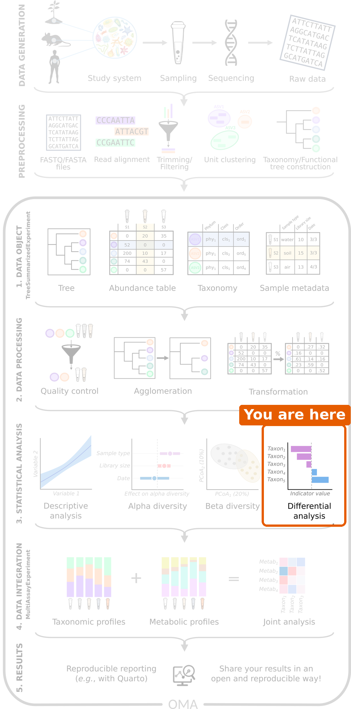
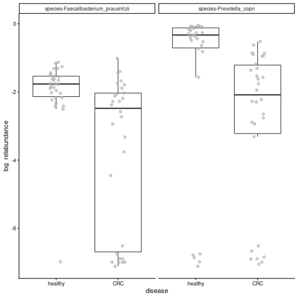
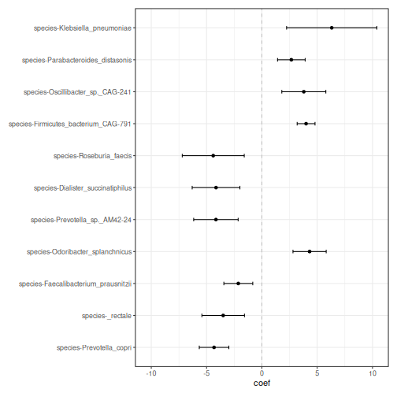
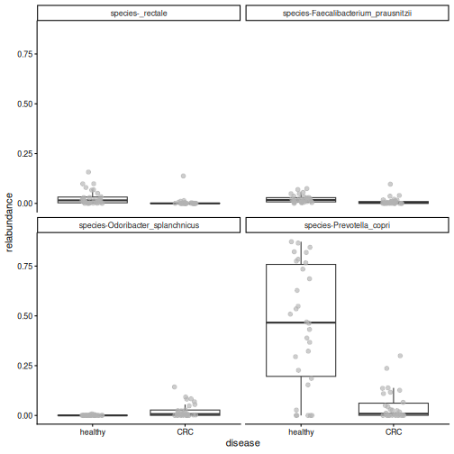
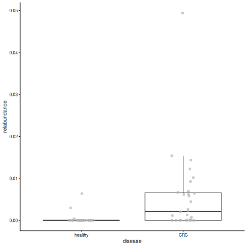
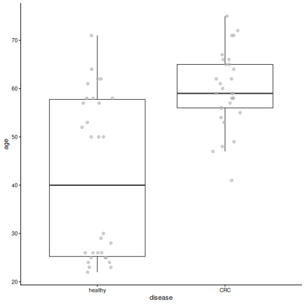

:::::::::::::::::::::::::::::::::::::: questions

- Which bacteria differ in abundance between people with colorectal cancer and healthy people?
- Which bacteria are found more often in one group than in the other?
- Why can we not test every taxon separately with a p-value threshold of 0.05?

::::::::::::::::::::::::::::::::::::::::::::::::

::::::::::::::::::::::::::::::::::::: objectives

- Explain what differential abundance analysis does, using a t-test and a linear model on two taxa.
- Explain why we correct for multiple testing, and why dedicated methods are used for microbiome data.
- Run a differential abundance and prevalence analysis with MaAsLin 3, taking another variable into account.
- Interpret the coefficients and q-values, and plot the data behind the results.

::::::::::::::::::::::::::::::::::::::::::::::::


## Where are we?



We now know that the gut microbiome of people with CRC differs from that of
healthy people, both in diversity and in overall composition. The last
question is: ***which* bacteria differ?**

## Load packages and data


``` r
library(mia)
library(miaViz)
library(maaslin3)
```

For the tests, we use the daa package again. We used its
`daa::getWilcoxonTest()` in the [alpha diversity episode](06-alpha-diversity.Rmd)
to test a `colData` column; here, its functions test the abundance of each
taxon. As before, we write `daa::` in front of its functions, for example
`daa::getTTest()`, instead of loading the package with `library()`.


``` r
tse <- readRDS(file.path("data", "tse_processed.rds"))
```

We set `healthy` as the first level of the `disease` factor. This makes it
the *reference* group, so the results below compare CRC *to* healthy people:


``` r
tse$disease <- factor(tse$disease, levels = c("healthy", "CRC"))
```

## Prepare the data

Abundances are very skewed: most values are small, and a few are very large.
We therefore test the **logarithm** of the relative abundance. The logarithm
of zero is not defined, so we first add a **pseudocount** of 1 to all counts.
We do this in two steps with `transformAssay()`: first we calculate relative
abundances from the counts plus one, and then we take their logarithm
(base 10):


``` r
tse <- transformAssay(
    tse, assay.type = "counts", method = "relabundance",
    pseudocount = 1, name = "relabundance_pseudo"
)
tse <- transformAssay(
    tse, assay.type = "relabundance_pseudo", method = "log10",
    name = "log_relabundance"
)
```

On the log10 scale, a difference of 1 means ten times more.

## Start with two taxa

Before testing hundreds of taxa, let's look at two that we have already met:
*Prevotella copri* and *Faecalibacterium prausnitzii*, a well-known butyrate
producer. We make a TreeSE with only these two taxa (rows):


``` r
tse_sub <- tse[
    c("species-Prevotella_copri", "species-Faecalibacterium_prausnitzii"),
]
```

We plot their log relative abundance in each group:


``` r
plotBoxplot(
    tse_sub, assay.type = "log_relabundance", x = "disease",
    facet.by = "rownames"
)
```



Both species tend to be more abundant in healthy people, but the groups
overlap. The idea of **differential abundance analysis (DAA)** is to test
whether differences like these are **statistically significant**, that is,
larger than we would expect by chance.

## A t-test

The simplest way to compare two groups is the **t-test**. The daa function
`daa::getTTest()` runs one t-test per taxon. Its formula reads "the
`log_relabundance` values are explained by `disease`". `var.equal = TRUE`
asks for the classic Student's t-test:


``` r
res_t <- daa::getTTest(tse_sub, log_relabundance ~ disease, var.equal = TRUE)
```

``` output
Registered S3 method overwritten by 'car':
  method           from
  na.action.merMod lme4
```

``` r
res_t
```

``` output
# A tibble: 2 × 9
  rownames               .y.   group1 group2    n1    n2 statistic    df       p
* <chr>                  <chr> <chr>  <chr>  <int> <int>     <dbl> <dbl>   <dbl>
1 species-Faecalibacter… log_… healt… CRC       30    30      3.79    58 3.62e-4
2 species-Prevotella_co… log_… healt… CRC       30    30      2.35    58 2.21e-2
```


Each row is one taxon (`rownames`), and the column `p` holds its p-value.

**Result:** both species differ between the groups: *P. copri*
(p = 0.022) and *F. prausnitzii*
(p = 0.00036).

The t-test is a very elementary method, but it is a valid choice for
microbiome data. A large comparison of DAA methods on 53 datasets found that
simple methods, such as t-tests and linear models, give results that
replicate better between datasets than many more complex methods
([Pelto et al. 2025](https://doi.org/10.1093/bib/bbaf130)).

## A linear model

A t-test can also be written as a **linear model**. The daa function
`daa::getLm()` fits one linear model per taxon, with the same formula:


``` r
res_lm <- daa::getLm(tse_sub, log_relabundance ~ disease)
res_lm
```

``` output
# A tibble: 2 × 5
  rownames                             variable   estimate  p_value  q_value
  <chr>                                <chr>         <dbl>    <dbl>    <dbl>
1 species-Prevotella_copri             diseaseCRC    -1.47 0.0221   0.0221  
2 species-Faecalibacterium_prausnitzii diseaseCRC    -1.71 0.000362 0.000723
```


The p-values (`p_value`) are the same as those of the t-test: **a t-test is
a linear model with one two-group variable**.

The advantage of the linear model is that we can add **other variables**,
called *covariates*. In the [beta diversity episode](07-beta-diversity.Rmd),
we saw that the location also affects the microbiome. We add `location` to
the formula, so that the effect of disease is tested *while taking the
location into account*:


``` r
res_loc <- daa::getLm(tse_sub, log_relabundance ~ disease + location)
res_loc
```

``` output
# A tibble: 4 × 5
  rownames                             variable       estimate  p_value  q_value
  <chr>                                <chr>             <dbl>    <dbl>    <dbl>
1 species-Prevotella_copri             diseaseCRC       -0.926 0.166    0.221   
2 species-Prevotella_copri             locationKerala   -1.48  0.0420   0.0841  
3 species-Faecalibacterium_prausnitzii diseaseCRC       -1.95  0.000204 0.000815
4 species-Faecalibacterium_prausnitzii locationKerala    0.634 0.234    0.234   
```


The results now have two rows per taxon: one for `diseaseCRC` and one for
`locationKerala`.

**Result:** *F. prausnitzii* is still less abundant in CRC
(p = 2e-04), but the disease effect
of *P. copri* is no longer significant
(p = 0.17). Most people from Kerala in
our study have CRC, so part of the difference of *P. copri* may be due to the
location rather than the disease.

Most DAA methods are based on this idea under the hood: they fit a model
like this for every taxon, with the group of interest and the covariates.

## Testing every taxon

So far we tested two taxa. In DAA, we usually test *every* taxon, and this
brings a new problem.

### Many tests, many false positives

With a p-value threshold of 0.05, we accept a 5 % chance of a false positive
in each test. That is fine for one test, but with 100 taxa, about 5 of them
would look significant by chance alone, even if nothing differed.

To avoid this, we **correct for multiple testing**. The corrected p-value is
often called the **q-value**. The usual threshold is q < 0.05. The most
common correction, the Benjamini–Hochberg method, controls the **false
discovery rate (FDR)**: if we report all taxa with q < 0.05, we expect at most
5 % of *the reported taxa* to be false positives.

::::::::::::::::::::::::::::::::::::: challenge

## Challenge 1: False positives

You test 200 taxa with a p-value threshold of 0.05, but in reality none of
them differ between the groups. About how many taxa will look significant
anyway?

:::::::::::::::::::::::: solution

About 200 × 0.05 = 10 taxa. This is why we correct for multiple testing.

:::::::::::::::::::::::::::::::::
::::::::::::::::::::::::::::::::::::::::::::::::

## Dedicated methods

The t-test and the linear model show what DAA does. Microbiome data has
special features, though. The values are relative, so if one taxon
increases, the shares of all others decrease. There are many zeros, as the
box plot above shows: the samples at the bottom are those where the taxon
was not detected at all. And the abundances are noisy: their spread changes
with their level (the data is *heteroscedastic*).

Dedicated DAA methods extend the linear model to take these features into
account. In this lesson we use **MaAsLin 3**. For each taxon, it fits two
models:

- **Abundance**: *when the taxon is present*, is it more abundant in one
  group? This is a linear model on the log relative abundance, like the one
  above, but it uses only the samples where the taxon was detected.
- **Prevalence**: is the taxon *present in more people* of one group? This
  is a logistic regression on presence and absence. Much of the information
  in microbiome data is in the prevalence: whether a taxon is there at all is
  much less noisy than how much of it there is.

MaAsLin 3 also compares each taxon with the typical (median) taxon, because
the data are relative, and it corrects the p-values for multiple testing.
Many other methods exist, for example ANCOM-BC2 and ALDEx2, and they often
give somewhat different results. See the
[Differential abundance chapter of OMA](https://bioconductor.org/books/release/OMA/pages/differential_abundance.html).

## Run MaAsLin 3

As discussed in [episode 5](05-explore-prepare.Rmd), we first remove rare
taxa. They carry little information and add many tests:


``` r
tse <- subsetByPrevalent(
    tse, assay.type = "relabundance",
    detection = 0.001, prevalence = 0.1
)
nrow(tse)
```

``` output
[1] 94
```

We give `maaslin3()` our TreeSE and a formula with disease and location.
Unlike in `daa::getLm()`, the left side of the formula is empty: MaAsLin 3
puts each taxon there in turn. It uses the first table of the TreeSE (the
counts) and transforms it itself. It writes its results to the folder given
in `output`. The last three arguments switch off its own plots and most of
its messages:


``` r
fit <- maaslin3(
    tse,
    formula = ~ disease + location,
    output = "maaslin3_output",
    plot_summary_plot = FALSE,
    plot_associations = FALSE,
    verbosity = "ERROR"
)
```

## Differential abundance

The results of the abundance model are in `fit$fit_data_abundance$results`.
The table has one row per taxon and variable, so we keep the rows for
disease, and then the taxa with q < 0.05:


``` r
res <- fit$fit_data_abundance$results
res <- res[res$metadata == "disease", ]
sig <- res[res$qval_individual < 0.05 & !is.na(res$qval_individual), ]
sig[, c("feature", "coef", "qval_individual")]
```

``` output
                                feature      coef qval_individual
1              species-Prevotella_copri -4.322978    3.137211e-06
3                      species-_rectale -3.499477    4.484035e-03
4  species-Faecalibacterium_prausnitzii -2.130628    4.484035e-03
5      species-Odoribacter_splanchnicus  4.312470    4.484035e-03
6        species-Prevotella_sp._AM42-24 -4.155679    4.484035e-03
7     species-Dialister_succinatiphilus -4.144146    8.424146e-03
8              species-Roseburia_faecis -4.396711    1.138791e-02
12 species-Firmicutes_bacterium_CAG-791  3.996070    2.555267e-02
13    species-Oscillibacter_sp._CAG-241  3.791330    2.976652e-02
16   species-Parabacteroides_distasonis  2.664330    4.367687e-02
17        species-Klebsiella_pneumoniae  6.313643    4.896360e-02
```

The most important columns are:

- `feature`: the taxon.
- `coef`: the effect size, the difference in log2 abundance. A **positive**
  value means the taxon is **more abundant in CRC**, a **negative** value
  that it is **less abundant in CRC**.
- `stderr`: the standard error of `coef`, that is, how uncertain it is.
- `qval_individual`: the q-value of this model, corrected for multiple
  testing.


**Result:** 11 of the 94 species differ in abundance
between people with CRC and healthy people: 5 are more abundant and
6 less abundant in CRC. The strongest result is *Prevotella copri*.
In the linear model above, its difference was weaker once the location was
taken into account. MaAsLin 3 looks only at the people who carry it, and
among them, *P. copri* is much less abundant in CRC.

A **forest plot** shows the coefficient of each significant taxon, with an
error bar for its uncertainty. The miaViz function `plotForest()` draws it
from the results table:


``` r
plotForest(
    sig, effect.var = "coef", err.var = "stderr",
    id.var = "feature", pval.var = "qval_individual"
)
```



It is always a good idea to look at the data behind a result. We plot the
relative abundances of the first four species of the list:


``` r
plotBoxplot(
    tse, assay.type = "relabundance", x = "disease",
    features = sig$feature[1:4], facet.by = "rownames"
)
```



**Result:** the differences are clearly visible in the data, although the
values of the two groups overlap.

::::::::::::::::::::::::::::::::::::: challenge

## Challenge 2: Read the forest plot

1. Name two species that are more abundant in CRC, and two that are less
   abundant in CRC.
2. *Faecalibacterium prausnitzii*, *Eubacterium rectale* (shown as
   `_rectale`) and *Roseburia faecis* produce butyrate, a compound that helps
   to keep the gut lining healthy. In which group are they more abundant?
   Does this make sense?

:::::::::::::::::::::::: solution

1. Species with a positive coefficient, such as *Odoribacter splanchnicus*,
   are more abundant in CRC. Species with a negative coefficient, such as
   *Prevotella copri* and *Faecalibacterium prausnitzii*, are less abundant
   in CRC.
2. They have negative coefficients: they are more abundant in healthy
   people. This makes sense: butyrate producers are often found to be
   depleted in CRC.

:::::::::::::::::::::::::::::::::
::::::::::::::::::::::::::::::::::::::::::::::::

::::::::::::::::::::::::::::::::::::: challenge

## Challenge 3: Without the location

1. Run MaAsLin 3 again with only `disease` in the formula. Save the results
   in a different folder, for example `maaslin3_output_disease_only`.
2. How many species differ in abundance (q < 0.05)?
3. How many of them were also significant in our first analysis?

*Hint: `intersect()` gives the elements that two vectors share.*

:::::::::::::::::::::::: solution


``` r
fit2 <- maaslin3(
    tse,
    formula = ~ disease,
    output = "maaslin3_output_disease_only",
    plot_summary_plot = FALSE,
    plot_associations = FALSE,
    verbosity = "ERROR"
)
res2 <- fit2$fit_data_abundance$results
res2 <- res2[res2$metadata == "disease", ]
sig2 <- res2[res2$qval_individual < 0.05 & !is.na(res2$qval_individual), ]

nrow(sig2)
```

``` output
[1] 12
```

``` r
length(intersect(sig$feature, sig2$feature))
```

``` output
[1] 9
```

2. 12 species are significant.
3. 9 of them were also
   significant when the location was taken into account.

Some species are significant only when the location is ignored
(3 here): their differences may
be partly due to the location rather than the disease. Others are
significant only when the location is in the formula
(2 here): taking the location
into account removes some of the noise, which makes a disease effect easier
to detect. The choice of variables in the formula matters.

:::::::::::::::::::::::::::::::::
::::::::::::::::::::::::::::::::::::::::::::::::

## Differential prevalence

The results of the prevalence model are in
`fit$fit_data_prevalence$results`. We keep the results for disease and the
taxa with q < 0.05:


``` r
res_prevalence <- fit$fit_data_prevalence$results
res_prevalence <- res_prevalence[res_prevalence$metadata == "disease", ]
sig_prevalence <- res_prevalence[
    res_prevalence$qval_individual < 0.05 &
        !is.na(res_prevalence$qval_individual),
]
sig_prevalence[, c("feature", "coef", "qval_individual")]
```

``` output
                                    feature      coef qval_individual
1             species-Bacteroides_eggerthii  3.815604     0.004484035
2              species-Bacteroides_fragilis  2.456524     0.004484035
4           species-Clostridium_sp._CAG-510  3.202124     0.004484035
5           species-Clostridium_sp._CAG-632  3.231433     0.004484035
6      species-Firmicutes_bacterium_CAG-238  3.788765     0.004484035
7            species-Flavonifractor_plautii  2.666713     0.004484035
8        species-Methanobrevibacter_smithii  3.145093     0.004484035
14          species-Bacteroides_sp._CAG-530  2.597764     0.011387908
15              species-Desulfovibrio_piger  2.572182     0.011387908
23     species-Bifidobacterium_adolescentis -2.035877     0.020664619
24                 species-Alistipes_shahii  2.028545     0.020883270
25            species-Klebsiella_pneumoniae -2.356969     0.021055323
26             species-Megasphaera_elsdenii -1.874297     0.021055323
29         species-Butyrivibrio_sp._CAG-318  2.258238     0.021186706
30           species-Roseburia_intestinalis -3.195097     0.021252854
35          species-Prevotella_sp._CAG-1092  2.031649     0.032098180
37 species-Intestinimonas_butyriciproducens  2.749107     0.032241998
38             species-Prevotella_stercorea  2.697288     0.036009251
41     species-Firmicutes_bacterium_CAG-110  1.956945     0.045155439
42            species-Mitsuokella_multacida -2.093394     0.048010635
3              species-Butyricimonas_virosa  2.922404     0.004484035
9                  species-Roseburia_faecis -2.894762     0.004484035
10  species-Ruthenibacterium_lactatiformans  2.758872     0.004484035
11              species-Veillonella_parvula  2.973239     0.004484035
12         species-Bacteroides_intestinalis  3.538988     0.006251335
13        species-Ligilactobacillus_ruminis -2.665089     0.011142771
17          species-Akkermansia_muciniphila  2.267651     0.014486316
18           species-Prevotella_sp._CAG-520  2.611054     0.016213310
19                         species-_rectale -2.209343     0.016605080
```

The prevalence model is a *logistic regression*: it models whether the taxon
is present or absent. Its `coef` is the change in the *log-odds* of the taxon
being present. The **odds** are the number of people who carry the taxon
divided by the number who do not: 15 carriers and 15 non-carriers give odds
of 1, 3 carriers and 27 non-carriers give odds of 1/9. You do not need to
interpret the exact value. A positive value means that the taxon is **found
more often in CRC**, and a negative value that it is found less often in CRC.


**Result:** 29 species differ in prevalence, of which 21
are found more often in CRC. Only 3 of them also differ in
abundance. The prevalence model finds many results that the abundance model
misses.

One of the prevalence results is *Flavonifractor plautii*. This is the
bacterium that the authors of our study highlighted in the title of their
paper. `getPrevalence()` gives the share of samples in which it is present,
in each group:


``` r
getPrevalence(tse[, tse$disease == "CRC"], assay.type = "counts")["species-Flavonifractor_plautii"]
```

``` output
species-Flavonifractor_plautii 
                     0.7333333 
```

``` r
getPrevalence(tse[, tse$disease == "healthy"], assay.type = "counts")["species-Flavonifractor_plautii"]
```

``` output
species-Flavonifractor_plautii 
                     0.1333333 
```


``` r
plotBoxplot(
    tse, assay.type = "relabundance", x = "disease",
    features = "species-Flavonifractor_plautii"
)
```




**Result:** *F. plautii* is present in 73 % of the
CRC patients but in only 13 % of the healthy
people. Its abundance is low in both groups: the clear difference is
*whether* it is there.

::::::::::::::::::::::::::::::::::::: challenge

## Challenge 4: *Bacteroides fragilis*

Some strains of *Bacteroides fragilis* produce a toxin that has been linked
to CRC.

1. Find `species-Bacteroides_fragilis` in the prevalence results. What are
   its `coef` and `qval_individual`?
2. In what share of the CRC patients and of the healthy people is it present?
3. Does the sign of its `coef` agree with these shares?

:::::::::::::::::::::::: solution


``` r
res_prevalence[
    res_prevalence$feature == "species-Bacteroides_fragilis",
    c("feature", "coef", "qval_individual")
]
```

``` output
                       feature     coef qval_individual
2 species-Bacteroides_fragilis 2.456524     0.004484035
```

``` r
getPrevalence(tse[, tse$disease == "CRC"], assay.type = "counts")["species-Bacteroides_fragilis"]
```

``` output
species-Bacteroides_fragilis 
                         0.8 
```

``` r
getPrevalence(tse[, tse$disease == "healthy"], assay.type = "counts")["species-Bacteroides_fragilis"]
```

``` output
species-Bacteroides_fragilis 
                   0.2333333 
```

*B. fragilis* is present in more CRC patients than healthy people. Its
`coef` is positive, which means "present more often in CRC", so the sign
agrees with the shares.

:::::::::::::::::::::::::::::::::
::::::::::::::::::::::::::::::::::::::::::::::::

::::::::::::::::::::::::::::::::::::: challenge

## Challenge 5 (optional): A famous CRC bacterium

*Fusobacterium nucleatum* is one of the bacteria most strongly linked to CRC
in the literature, yet it is not in our results. Find out why.

*Hint: load the unfiltered data from `data/tse_processed.rds` and calculate
the prevalence of `species-Fusobacterium_nucleatum` with `getPrevalence()`.*

:::::::::::::::::::::::: solution


``` r
tse_all <- readRDS(file.path("data", "tse_processed.rds"))
prevalence <- getPrevalence(tse_all, assay.type = "counts")
prevalence["species-Fusobacterium_nucleatum"]
```

``` output
species-Fusobacterium_nucleatum 
                     0.06666667 
```

*F. nucleatum* was detected in only
7 % of the
people, so our prevalence filter (at least 10 % of samples) removed it before
the analysis. Filtering always involves a trade-off: it makes the analysis
more robust, but it can remove taxa that are rare but interesting.

:::::::::::::::::::::::::::::::::
::::::::::::::::::::::::::::::::::::::::::::::::

::::::::::::::::::::::::::::::::::::: challenge

## Challenge 6: How robust are the results? (30 minutes)

Our results depend on choices we made: the variables in the formula and the
taxonomic rank. In this exercise, you test how robust they are.

The CRC patients in our study are older than the healthy people (median age
59 vs
40 years), and age also affects
the gut microbiome.

1. Plot `age` by `disease` with `plotBoxplot()`. Are there CRC patients
   under 40?
2. Run MaAsLin 3 with `formula = ~ disease + location + age` (output folder
   `maaslin3_output_age`). How many species differ in abundance by disease
   (q < 0.05)? Are any species associated with age itself?
3. Now repeat the analysis with `~ disease + location` at the **genus**
   level (output folder `maaslin3_output_genus`). Load the full data again,
   agglomerate it with `agglomerateByRank()`, and prepare it as at the start
   of this episode. How many genera differ in abundance?
4. Is the genus *Prevotella* significant? Compare with the species-level
   result for *Prevotella copri*.
5. Write two or three sentences: which findings are robust to these choices,
   and which are not?

:::::::::::::::::::::::: solution

**1. Age by disease**


``` r
plotBoxplot(tse, col.var = "age", x = "disease")
```



``` r
min(tse$age[tse$disease == "CRC"])
```

``` output
[1] 41
```

All CRC patients are at least 41 years
old, while many healthy people are younger.

**2. MaAsLin 3 with age**


``` r
fit_age <- maaslin3(
    tse,
    formula = ~ disease + location + age,
    output = "maaslin3_output_age",
    plot_summary_plot = FALSE,
    plot_associations = FALSE,
    verbosity = "ERROR"
)
res_age <- fit_age$fit_data_abundance$results
res_age <- res_age[res_age$qval_individual < 0.05 & !is.na(res_age$qval_individual), ]

sig_age_disease <- res_age[res_age$metadata == "disease", ]
sig_age_disease[, c("feature", "coef", "qval_individual")]
```

``` output
                               feature      coef qval_individual
1             species-Prevotella_copri -4.270148    0.0002874643
3 species-Faecalibacterium_prausnitzii -2.512047    0.0441288103
```

``` r
sum(res_age$metadata == "age")
```

``` output
[1] 0
```

With age in the formula, 2 species differ by disease
(11 without age), and 0 species
are associated with age. Age and disease are strongly linked in this study,
so when both are in the model, it is hard to tell which of them explains a
difference. The uncertainty of the disease effect grows and fewer results
pass the threshold. To separate the effects of age and disease, we would need
a study design in which the groups have similar ages (for example,
age-matched controls).

**3. and 4. Genus level**


``` r
tse_genus <- readRDS(file.path("data", "tse_processed.rds"))
tse_genus <- agglomerateByRank(tse_genus, rank = "genus")
tse_genus$disease <- factor(tse_genus$disease, levels = c("healthy", "CRC"))
tse_genus <- transformAssay(
    tse_genus, assay.type = "counts", method = "relabundance"
)
tse_genus <- subsetByPrevalent(
    tse_genus, assay.type = "relabundance",
    detection = 0.001, prevalence = 0.1
)

fit_genus <- maaslin3(
    tse_genus,
    formula = ~ disease + location,
    output = "maaslin3_output_genus",
    plot_summary_plot = FALSE,
    plot_associations = FALSE,
    verbosity = "ERROR"
)
res_genus <- fit_genus$fit_data_abundance$results
res_genus <- res_genus[res_genus$metadata == "disease", ]
sum(res_genus$qval_individual < 0.05, na.rm = TRUE)
```

``` output
[1] 7
```

``` r
res_genus[res_genus$feature == "Prevotella", c("feature", "coef", "qval_individual")]
```

``` output
      feature      coef qval_individual
12 Prevotella -1.388461      0.05567889
```


At the genus level, 7
genera differ in abundance. The genus *Prevotella* is
not significant
(q = 0.056), although *Prevotella copri* was
the strongest species-level result. The genus also contains other
*Prevotella* species, and some of them, such as *Prevotella* sp. CAG-520,
tend to be *more* abundant in CRC. Summing them with *P. copri* blurs the
difference.

**5. Conclusion**

Results that hold across formulas and ranks are the most robust, for
example the lower abundance of *Prevotella copri* and of the butyrate
producer *Faecalibacterium prausnitzii* in CRC, which remain significant
when age is added. Other results change when age is added or when we move to the genus level. The rank you analyse changes the
question: "which species?" and "which genera?" are not the same question.

:::::::::::::::::::::::::::::::::
::::::::::::::::::::::::::::::::::::::::::::::::

::::::::::::::::::::::::::::::::::::: keypoints

- Differential abundance analysis tests whether the differences we see in plots are statistically significant.
- At its core, DAA is a simple test: a t-test is a linear model with one two-group variable, and a linear model can add covariates, such as the location. Most DAA methods are based on this under the hood.
- Testing many taxa produces false positives, so we use q-values that are corrected for multiple testing.
- Dedicated methods, such as MaAsLin 3, extend the linear model to take the specific nature of microbiome data into account: relative values, many zeros and noisy abundances.
- A taxon can differ in abundance, in prevalence (how often it is present), or both. MaAsLin 3 tests both.
- Look at the data behind the results, and treat significant taxa as candidates for further study.
- In our study, *Prevotella copri* and butyrate-producing species are less abundant in people with CRC, and *Flavonifractor plautii* is found much more often in CRC.

::::::::::::::::::::::::::::::::::::::::::::::::
