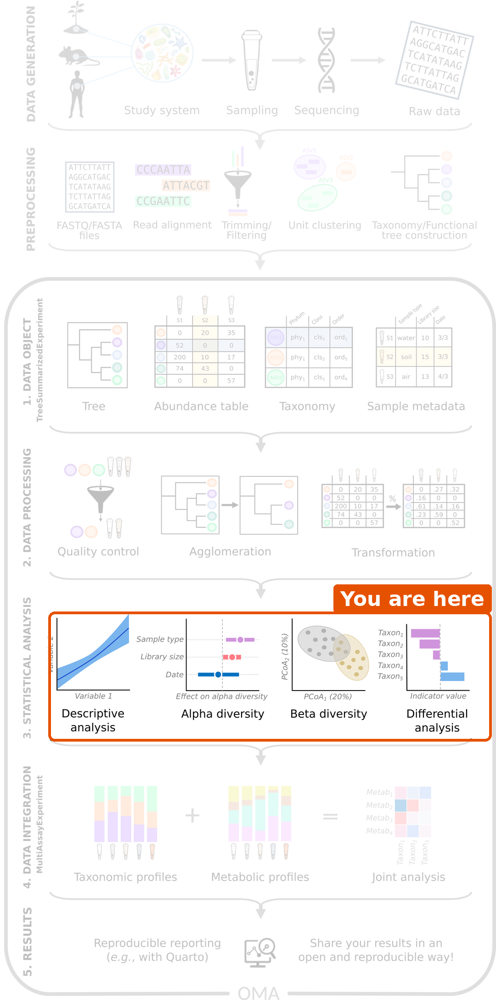
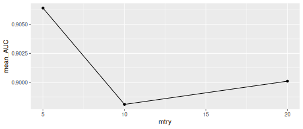
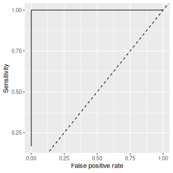
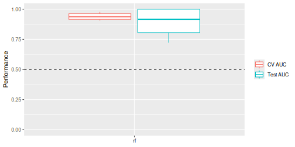
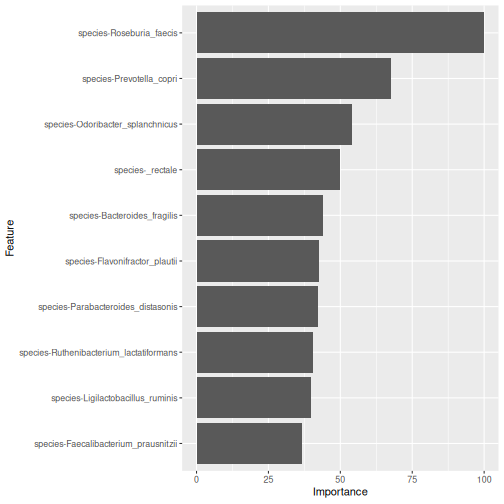

:::::::::::::::::::::::::::::::::::::: questions

- How well can we predict an outcome, such as colorectal cancer, from the gut microbiome?
- Why do we split the data into training and test data?
- Which bacteria are the most important for the prediction?

::::::::::::::::::::::::::::::::::::::::::::::::

::::::::::::::::::::::::::::::::::::: objectives

- Explain the terms feature, outcome, training data, test data, overfitting, cross-validation and AUC.
- Train a random forest model with mikropml to predict an outcome (here, the disease) from the abundance table.
- Evaluate a model with the cross-validation AUC and the test AUC, and explain why a single small test set is unreliable.
- Find the most important taxa of a model and compare them with the differential abundance results.

::::::::::::::::::::::::::::::::::::::::::::::::


## Where are we?



We are still in the **statistical analysis** step. In the
[beta diversity episode](07-beta-diversity.Rmd), the samples of people with
CRC and healthy people largely separated in the ordination plots, and in the
last episode we found *which* species differ between the groups. The
next question is a practical one: *if we only had a stool sample, how well could
we tell whether the person has CRC?* This is a **prediction** question, and
machine learning is the usual tool for it. The outcome we predict can be
anything we know about the samples, for example a disease, a treatment
response or a diet; in our study, it is the disease.

## Load packages and data


``` r
library(mia)
library(miaViz)
library(mikropml)
library(ggplot2)
```


``` r
tse <- readRDS(file.path("data", "tse_processed.rds"))
```

## What is machine learning?

So far we have asked *whether* the groups differ. Machine learning asks
whether we can *predict* the group of a new sample. A few terms:

| Term | Meaning | In our data |
|---|---|---|
| **Outcome** | What we want to predict | `disease`: CRC or healthy |
| **Features** | What we use to predict it | The abundances of the taxa |
| **Model** | A set of rules learned from the data | A random forest |
| **Hyperparameter** | A setting of the model that is chosen before training, not learned from the data | `mtry` of the random forest (see below) |
| **Training data** | The samples the model learns from | 80 % of the samples |
| **Test data** | Samples kept aside to check the model | The other 20 % |

### Why keep test data aside?

A flexible model can learn the training data *by heart*, including its
random noise. It then looks perfect on the training data but fails on new
samples. This is called **overfitting**. To get an honest estimate of how
well the model works, we test it on samples that it has **never seen**.

The data is used like this:

1. The samples are split into **training data** (80 %) and **test data** (20 %).
2. On the training data, the model is tuned with **cross-validation**: the
   training data is split into 5 parts (*folds*), the model is trained on 4
   and checked on the 5th, and this is repeated so that each fold is used for
   checking once. This gives the **cross-validation (CV) performance**.
   *Tuning* means that this is done for several values of the
   hyperparameters, and the values with the best CV performance are kept.
3. The final model is checked once on the test data. This gives the **test
   performance**.

### Measuring performance: AUC

For each sample, the model gives a probability of CRC. The **AUC** (area
under the ROC curve) measures how well these probabilities rank the samples:

- **AUC = 1**: every CRC sample gets a higher probability than every healthy sample.
- **AUC = 0.5**: no better than flipping a coin.

To turn the probabilities into a yes/no prediction, we need a cut-off, for
example "CRC if the probability is above 0.5". The **ROC curve** (receiver
operating characteristic) shows what happens for *every* possible cut-off:
how many of the CRC samples are found (the *sensitivity*), against how many
of the healthy samples are wrongly called CRC (the *false positive rate*).
The AUC is the area under this curve, so it does not depend on one chosen
cut-off. Another common measure, the **accuracy**, is the share of
samples predicted correctly at one cut-off.

::::::::::::::::::::::::::::::::::::: challenge

## Challenge 1: Training and test data

A student trains a model on all 60 samples and then checks it on the same
samples. The model gets an AUC of 1.0. Should the student be happy? Why or
why not?

:::::::::::::::::::::::: solution

No. The model was checked on the samples it learned from, so it may have
memorized them (overfitting). The AUC of 1.0 says nothing about how the
model works for new people. The model must be checked on samples it has not
seen, such as a separate test set.

:::::::::::::::::::::::::::::::::
::::::::::::::::::::::::::::::::::::::::::::::::

## Prepare the data

We use the same taxa as in the
[differential abundance episode](08-differential-abundance.Rmd): the species
that are found in at least 10 % of the samples.


``` r
tse_prevalent <- subsetByPrevalent(
    tse, assay.type = "relabundance",
    detection = 0.001, prevalence = 0.1
)
```

We use the raw counts as features: a random forest splits each feature into
"high" and "low" values, so it does not need normally distributed or
transformed data.

## Train a random forest

A **random forest** is a collection of many decision trees. Each tree asks a
series of questions such as "is the count of *Prevotella copri* above 10
000?" and ends with a prediction. The forest predicts by majority vote of its
trees.

The most important hyperparameter of a random forest is `mtry`: the number
of randomly chosen features that each question in a tree can pick from. A
small `mtry` makes the trees more different from each other; a large `mtry`
makes each tree stronger on its own. The best value depends on the data, so
we let cross-validation choose it.

The mikropml function `run_ml()` works directly with a TreeSE. We give it
the outcome as a column of `colData` (`outcome_colname`) and the features as
an abundance table (`assay.type`). It then does all the steps from above: it
splits the data into training and test data, tunes `mtry` with 5-fold
cross-validation (`kfold = 5`, repeated `cv_times = 5` times with different
folds), and tests the final model. The `seed` makes the random split
reproducible.


``` r
rf_results <- run_ml(
    tse_prevalent, method = "rf", outcome_colname = "disease",
    assay.type = "counts", kfold = 5, cv_times = 5, seed = 123
)
```


The mikropml functions `get_hp_performance()` and `plot_hp_performance()`
show the CV AUC for each value of `mtry` that was tried:


``` r
hp <- get_hp_performance(rf_results$trained_model)
plot_hp_performance(hp$dat, mtry, AUC)
```



**Result:** all values of `mtry` give a similar CV AUC (note the narrow
range of the y-axis), and `run_ml()` kept
`mtry` = 5, the value with the highest CV AUC.

### Evaluate the model

The performance is stored in `rf_results$performance`. The two most
important columns are the cross-validation AUC of the chosen model and the
test AUC:


``` r
rf_results$performance[, c("cv_metric_AUC", "AUC")]
```

``` output
# A tibble: 1 × 2
  cv_metric_AUC   AUC
          <dbl> <dbl>
1         0.906     1
```

The mikropml function `calc_model_sensspec()` predicts the test data with
the trained model and calculates the sensitivity and false positive rate for
every cut-off. We plot them as a ROC curve. The dashed line is a model that
guesses at random (AUC = 0.5):


``` r
sensspec <- calc_model_sensspec(
    rf_results$trained_model, rf_results$test_data, "disease"
)
```

``` output
Using 'disease' as the outcome column.
```

``` r
ggplot(sensspec, aes(x = fpr, y = sensitivity)) +
    geom_step() +
    geom_abline(linetype = "dashed") +
    labs(x = "False positive rate", y = "Sensitivity")
```



**Result:** the cross-validation AUC is 0.91, and the test
AUC is 1. The gut microbiome predicts CRC very well in
this study.

The CV AUC was used to choose `mtry`, so it is slightly optimistic. The test
data was not used for any choice, so the test AUC is the honest estimate.

But the test set contains only 12 samples. With so few samples, a
single lucky or unlucky split can change the test AUC a lot. Challenge 2
explores this.

::::::::::::::::::::::::::::::::::::: instructor

`run_ml()` takes a few seconds. It loads the caret package, which masks some
functions, for example `mia::cluster()`. This does not matter in this
episode, but in a session that also uses clustering, call such functions with
`mia::` in front.

::::::::::::::::::::::::::::::::::::::::::::::::

::::::::::::::::::::::::::::::::::::: challenge

## Challenge 2: How reliable is one test set?

The split into training and test data is random, and it is set by `seed`.
Let's see how much the test AUC depends on it.

1. Train the same random forest three more times, with `seed = 4`,
   `seed = 5` and `seed = 6`. Store the results as `rf_4`, `rf_5` and `rf_6`.
2. Combine the performance tables of the four models (`rf_results` and the
   three new ones) with `rbind()`, and plot them with the mikropml function
   `plot_model_performance()`.
3. What are the smallest and largest test AUCs? What does this tell you about
   reporting the AUC of a single split?
4. Do the cross-validation AUCs vary as much? Why might that be?

:::::::::::::::::::::::: solution


``` r
rf_4 <- run_ml(
    tse_prevalent, method = "rf", outcome_colname = "disease",
    assay.type = "counts", kfold = 5, cv_times = 5, seed = 4
)
rf_5 <- run_ml(
    tse_prevalent, method = "rf", outcome_colname = "disease",
    assay.type = "counts", kfold = 5, cv_times = 5, seed = 5
)
rf_6 <- run_ml(
    tse_prevalent, method = "rf", outcome_colname = "disease",
    assay.type = "counts", kfold = 5, cv_times = 5, seed = 6
)
performance <- rbind(
    rf_results$performance, rf_4$performance,
    rf_5$performance, rf_6$performance
)
performance[, c("seed", "cv_metric_AUC", "AUC")]
```

``` output
# A tibble: 4 × 3
   seed cv_metric_AUC   AUC
  <dbl>         <dbl> <dbl>
1   123         0.906 1    
2     4         0.958 0.833
3     5         0.919 1    
4     6         0.978 0.722
```


``` r
plot_model_performance(performance)
```



3. The test AUC ranges from 0.72 to 1.
   A single split of a small dataset
   can make a model look perfect or mediocre by chance. Report the
   performance over many splits (for example the median and range), not
   from one split. In practice, people use many more splits, for example
   100; the [mikropml documentation](https://www.schlosslab.org/mikropml/articles/parallel.html)
   shows how to run them efficiently.
4. The cross-validation AUCs vary less (from 0.91
   to 0.98), because each one is an
   average over 25 folds (5 folds, repeated 5 times) that together use all
   48 training samples, while the test AUC comes from only
   12 samples.

:::::::::::::::::::::::::::::::::
::::::::::::::::::::::::::::::::::::::::::::::::

## Which taxa matter most?

A model that predicts well is useful, but we also want to know *which*
features it relies on. A random forest measures the **importance** of each
feature: how much the questions about this feature help the trees to
separate CRC from healthy samples, summed over all trees. mikropml trains
the model with the caret package, so we get the importances with the caret
function `varImp()`. It scales them from 0 (least important) to 100 (most
important) and prints the most important features first:


``` r
importance <- caret::varImp(rf_results$trained_model)
importance
```

``` output
rf variable importance

  only 20 most important variables shown (out of 94)

                                        Overall
species-Roseburia_faecis                 100.00
species-Prevotella_copri                  67.75
species-Odoribacter_splanchnicus          54.15
species-_rectale                          50.03
species-Bacteroides_fragilis              44.09
species-Flavonifractor_plautii            42.44
species-Parabacteroides_distasonis        42.16
species-Ruthenibacterium_lactatiformans   40.52
species-Ligilactobacillus_ruminis         39.92
species-Faecalibacterium_prausnitzii      36.55
species-Bacteroides_thetaiotaomicron      31.23
species-Bifidobacterium_adolescentis      30.58
species-Methanobrevibacter_smithii        29.87
species-Megasphaera_elsdenii              27.18
species-Alistipes_shahii                  24.88
species-Escherichia_coli                  23.32
species-Phocaeicola_vulgatus              20.12
species-Parabacteroides_merdae            19.54
species-Akkermansia_muciniphila           19.42
species-Bacteroides_intestinalis          18.99
```

caret also provides a `ggplot()` method for this object. We plot the ten
most important species:


``` r
ggplot(importance, top = 10)
```




**Result:** the most important species is *Roseburia faecis*, followed by
*Prevotella copri* and *Odoribacter splanchnicus*. Compare them with the
differential abundance results of
[episode 8](08-differential-abundance.Rmd): many of the same species appear
in both. Two very different methods point to the same bacteria.

::::::::::::::::::::::::::::::::::::: callout

## Other importance measures

mikropml can also calculate *permutation importance* with
`run_ml(..., find_feature_importance = TRUE)`: it shuffles one feature at a
time in the test data and measures how much the test AUC drops. With only
12 test samples, this estimate is very noisy, so we use the
importance from the random forest itself. See the
[mikropml documentation](https://www.schlosslab.org/mikropml/articles/introduction.html).

:::::::::::::::::::::::::::::::::::::::::::::::

::::::::::::::::::::::::::::::::::::: callout

## Importance is not a difference

Feature importance tells us that a taxon *helps the model to predict*, but
not in which direction: it does not say whether the taxon is higher in CRC
or in healthy people. For that, look at the differential abundance results or
plot the taxon by group with `plotBoxplot()`.

:::::::::::::::::::::::::::::::::::::::::::::::

::::::::::::::::::::::::::::::::::::: challenge

## Challenge 3: A different model

mikropml supports other models too. A popular one is a regularized logistic
regression, `method = "glmnet"`. Unlike a random forest, it combines the
features in a weighted sum, so it works best when the features are on a
similar scale.

1. Prepare the **relative abundances** of `tse_prevalent` with the mikropml
   function `preprocess_data()`
   (`outcome_colname = "disease"`, `assay.type = "relabundance"`). By
   default, it centres and scales each feature and removes features that
   carry no information. It adds the result to the TreeSE as a new table
   called `preprocessed`.
2. Train a `glmnet` model on the `preprocessed` table with the same settings
   as before.
3. Compare its cross-validation AUC with the random forest.

:::::::::::::::::::::::: solution


``` r
tse_glm <- preprocess_data(
    tse_prevalent, outcome_colname = "disease", assay.type = "relabundance"
)
assayNames(tse_glm)
```

``` output
[1] "counts"       "relabundance" "rclr"         "preprocessed"
```

``` r
glm_results <- run_ml(
    tse_glm, method = "glmnet", outcome_colname = "disease",
    assay.type = "preprocessed", kfold = 5, cv_times = 5, seed = 123
)
glm_results$performance[, c("cv_metric_AUC", "AUC")]
```

``` output
# A tibble: 1 × 2
  cv_metric_AUC   AUC
          <dbl> <dbl>
1         0.884     1
```

The glmnet model has a cross-validation AUC of
0.88, compared with
0.91 for the random forest. Both predict CRC well. With
only 60 samples, a small difference between the models could change
with another split. glmnet is much faster, which matters for large datasets.

If `preprocess_data()` removes features, it stores the result as an
alternative experiment instead, and you give `run_ml()` also
`altexp = "preprocessed"`. See the
[Machine learning chapter of OMA](https://bioconductor.org/books/release/OMA/pages/machine_learning.html).

:::::::::::::::::::::::::::::::::
::::::::::::::::::::::::::::::::::::::::::::::::

::::::::::::::::::::::::::::::::::::: challenge

## Challenge 4: Genus level

Does the model work as well at the genus level?

1. Agglomerate the data to the genus level with `agglomerateByRank()`.
2. Filter and train a random forest as above.
3. Compare the cross-validation AUC with the species-level model.

:::::::::::::::::::::::: solution


``` r
tse_genus <- agglomerateByRank(tse, rank = "genus")
tse_genus <- transformAssay(
    tse_genus, assay.type = "counts", method = "relabundance"
)
tse_genus <- subsetByPrevalent(
    tse_genus, assay.type = "relabundance",
    detection = 0.001, prevalence = 0.1
)
genus_results <- run_ml(
    tse_genus, method = "rf", outcome_colname = "disease",
    assay.type = "counts", kfold = 5, cv_times = 5, seed = 123
)
genus_results$performance[, c("cv_metric_AUC", "AUC")]
```

``` output
# A tibble: 1 × 2
  cv_metric_AUC   AUC
          <dbl> <dbl>
1         0.931 0.944
```

With 52 genera, the cross-validation AUC is
0.93, about the same as
with species (0.91). The signal is strong at both levels.

:::::::::::::::::::::::::::::::::
::::::::::::::::::::::::::::::::::::::::::::::::

::::::::::::::::::::::::::::::::::::: challenge

## Challenge 5: Is it really the disease?

In our study, most people from Kerala have CRC
([episode 4](04-import-treese.Rmd)).

1. Make a table of `location` against `disease`.
2. Imagine a very simple "model": *predict CRC for everyone from Kerala and
   healthy for everyone from Bhopal*. What share of the people would it
   classify correctly?
3. What does this mean for our microbiome model?

:::::::::::::::::::::::: solution


``` r
location_table <- table(tse$location, tse$disease)
location_table
```

``` output
        
         CRC healthy
  Bhopal  15      26
  Kerala  15       4
```

``` r
correct <- location_table["Kerala", "CRC"] + location_table["Bhopal", "healthy"]
correct / ncol(tse)
```

``` output
[1] 0.6833333
```

2. The simple rule classifies 68 % of the
   people correctly, without looking at any bacteria.
3. Part of what the model learns could be the difference between Bhopal and Kerala
   rather than the disease. The microbiome model is much better than the
   location alone, but to be sure, it should be tested on new people, ideally
   from other places, or trained within one place only.

:::::::::::::::::::::::::::::::::
::::::::::::::::::::::::::::::::::::::::::::::::

::::::::::::::::::::::::::::::::::::: callout

## Before trusting a prediction model

- **Small data.** With 60 samples, performance estimates are uncertain.
  Report results over many splits.
- **Independent validation.** A model should be tested on an independent
  cohort, collected by other people in another place. Models often perform
  worse there.
- **Confounding.** If the groups differ in other ways (location, age,
  medication), the model may learn those differences instead of the disease.

See the [Machine learning chapter of OMA](https://bioconductor.org/books/release/OMA/pages/machine_learning.html).

:::::::::::::::::::::::::::::::::::::::::::::::

::::::::::::::::::::::::::::::::::::: keypoints

- Machine learning asks how well we can *predict* an outcome, such as a disease, from features, such as taxon abundances.
- Always evaluate a model on samples it has not seen: cross-validation on the training data and a separate test set.
- Hyperparameters, such as `mtry` of a random forest, are chosen by cross-validation on the training data only.
- mikropml works directly with a TreeSE: `run_ml()` trains, tunes and tests a model in one call, and `preprocess_data()` prepares the data when a model needs it. Random forests work on raw counts.
- The AUC measures how well the predictions separate the groups. With a small test set, it varies a lot between random splits.
- Feature importance shows which taxa the model relies on. In our study, many of them, such as *Roseburia faecis*, also differ in abundance.
- Confounders and small sample sizes can make a model look better than it is; independent validation is needed.

::::::::::::::::::::::::::::::::::::::::::::::::
