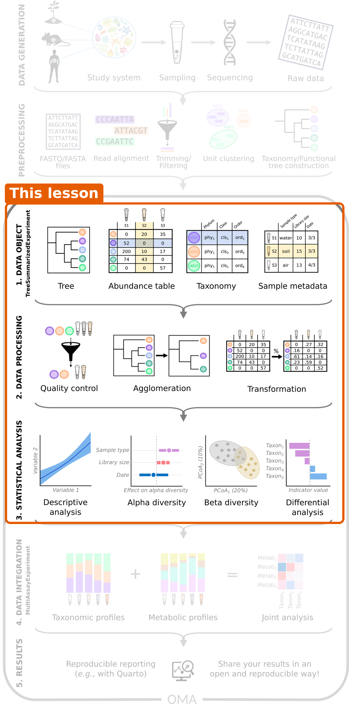

:::::::::::::::::::::::::::::::::::::: questions

- What did we learn about our study?
- Where can I learn more?

::::::::::::::::::::::::::::::::::::::::::::::::

::::::::::::::::::::::::::::::::::::: objectives

- Summarize the analysis workflow of this lesson.
- Find resources for further learning.

::::::::::::::::::::::::::::::::::::::::::::::::

## What we did

We have gone through the data object, data processing and statistical
analysis steps of the microbiome data science workflow. We
started with one question: *is the gut microbiome of people with colorectal
cancer different from that of healthy people, and which bacteria differ?*
Step by step, we found an answer:

| Episode | Step | What we learned about the study |
|---|---|---|
| 4 | Import | The data fits into one `TreeSummarizedExperiment`. Most healthy people come from Bhopal. |
| 5 | Explore and prepare | Library sizes differ between samples. *Prevotella* dominates many healthy samples. |
| 6 | Alpha diversity | CRC patients have *higher* diversity, partly because many healthy samples are dominated by *Prevotella* and are therefore less even. |
| 7 | Beta diversity and clustering | The overall composition of the two groups differs, also when the location is taken into account. The samples fall into a *Prevotella* and a non-*Prevotella* community type. |
| 8 | Differential abundance and prevalence | Several species differ. *Prevotella copri* and butyrate producers such as *Faecalibacterium prausnitzii* are less abundant in CRC. Others differ in how *often* they are present, for example *Flavonifractor plautii*, which is found much more often in CRC. Others differ in how *often* they are present, for example *Flavonifractor plautii*, which is found much more often in CRC. |
| 9 | Machine learning | The microbiome predicts CRC well, but with only 60 people the estimate is uncertain and an independent cohort is needed. |
| 10 | Capstone | The same workflow works on a new dataset, even when it finds few differences. |

The same workflow works for most microbiome studies: import the data, explore
and prepare it, analyse alpha diversity, beta diversity and differential
abundance, and then go further with clustering, machine learning or
multi-omics.

## Where to go next

This lesson covered the basics. The online book
**[Orchestrating Microbiome Analysis (OMA)](https://bioconductor.org/books/release/OMA/)**
goes deeper into each topic and covers many more. Good places to continue:

- **Your own data**: importing data from QIIME 2, MetaPhlAn, mothur, BIOM
  files and phyloseq objects
  ([Import chapter](https://bioconductor.org/books/release/OMA/pages/import.html)).
- **More about each step**: quality control, other transformations, other
  diversity indices and distances, rarefaction, other differential abundance
  methods, and other clustering and machine learning methods.
- **Multi-omics**: combining the microbiome with other data types, such as
  metabolites, is the topic of the follow-up
  [multi-omics lesson](https://microbiome.github.io/multiomics-lesson/). It covers
  `MultiAssayExperiment`, exploratory methods (Mantel test, MiRKAT, pairwise
  associations), unsupervised methods (joint RPCA, MOFA) and supervised
  methods (IntegratedLearner, DIABLO).
- **Your own analysis**: apply the workflow to your own data, and report it
  in a reproducible way, for example with Quarto.

Other resources:

- [OMA framework](https://microbiome.github.io/): the R/Bioconductor packages
  for microbiome data science.
- [Training slides](https://microbiome.github.io/outreach/): slides on many
  microbiome analysis topics.
- [Bioconductor support site](https://support.bioconductor.org/): ask
  questions about Bioconductor packages, using the tags `mia` or `miaViz`.

::::::::::::::::::::::::::::::::::::: keypoints

- A typical microbiome analysis goes from import and preparation to alpha diversity, beta diversity and differential abundance.
- These three analyses are what most studies report. They are sometimes enough on their own, and they are always the first steps before more advanced analyses.
- The OMA book is the place to continue learning, and the follow-up multi-omics lesson shows how to combine the microbiome with other data types.

::::::::::::::::::::::::::::::::::::::::::::::::
