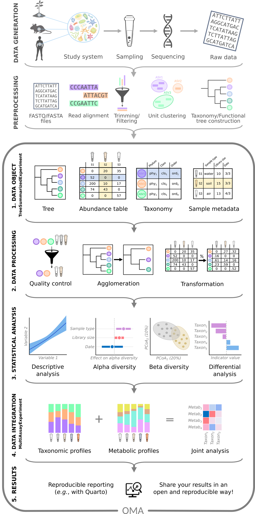

:::::::::::::::::::::::::::::::::::::: questions

- What is microbiome data?
- How is microbiome data produced?
- What will we learn to do with it in this lesson?

::::::::::::::::::::::::::::::::::::::::::::::::

::::::::::::::::::::::::::::::::::::: objectives

- Describe the steps of a microbiome study, and point out which steps this lesson covers.
- Name the four parts of a microbiome dataset.
- Explain why we compare proportions instead of raw read counts.
- State the research question of the study used in this lesson, and name
  factors other than the disease that could affect the answer.

::::::::::::::::::::::::::::::::::::::::::::::::

## What is a microbiome?

Our bodies, as well as soil, oceans and plants, are home to huge communities
of microorganisms: bacteria, archaea, fungi and viruses. Such a community,
together with its environment, is called a **microbiome**.

The gut microbiome helps us digest food, trains our immune system and protects
us from pathogens. Changes in the gut microbiome have been linked to many
diseases, including colorectal cancer, which is the topic of our example
study.

To study a microbiome, we need to know *who is there* and *how much* of each.
This is what microbiome sequencing measures.

```{r data-facts, include=FALSE}
counts <- read.csv(file.path("data", "taxonomy_abundance.csv"), row.names = 1)
samples <- read.csv(file.path("data", "sample_metadata.csv"), row.names = 1)
zero_share <- round(100 * mean(counts == 0))
lib_min <- round(min(colSums(counts)) / 1e6, 1)
lib_max <- round(max(colSums(counts)) / 1e6, 1)
n_groups <- table(samples$disease)
```

## The microbiome data science workflow

A microbiome study goes through the same steps from start to finish. The
figure below shows them as a workflow, from top to bottom.

```{r workflow-overview, echo=FALSE, out.width="55%", fig.alt="Workflow of a microbiome study, from top to bottom. Data generation: study system, sampling, sequencing and raw data. Preprocessing: FASTQ files, read alignment, trimming and filtering, unit clustering, and taxonomy and tree construction. Then five numbered steps: 1. data object (tree, abundance table, taxonomy and sample metadata), 2. data processing (quality control, agglomeration and transformation), 3. statistical analysis (descriptive analysis, alpha diversity, beta diversity and differential analysis), 4. data integration (taxonomic and metabolic profiles combined in a joint analysis) and 5. results (reproducible reporting)."}

```

*Figure: microbiome data science workflow. Source: [OMA](https://bioconductor.org/books/release/OMA/).*

First, the data is produced:

- **Data generation**: a study system, such as people, animals or soil, is
  sampled. The DNA of each sample is sequenced, which gives the *raw data*:
  millions of short DNA sequences, called *reads*.
- **Pre-processing**: specialized tools clean the reads, group them and find
  out which taxa (groups of related organisms, such as species) they come
  from. The result is a set of tables.

Then the tables are analysed, in five numbered steps:

1. **Data object**: the tables (abundance table, taxonomy, sample metadata
   and tree) are imported into R and stored together in one object.
2. **Data processing**: the data is checked, summarized at different
   taxonomic levels (*agglomeration*) and transformed.
3. **Statistical analysis**: we answer the research question, for example
   with alpha diversity, beta diversity and differential abundance analysis.
4. **Data integration**: the microbiome is combined with other data types
   measured from the same samples, such as metabolites.
5. **Results**: we report what we found, in a reproducible way.

**This lesson covers the analysis of a single abundance table: steps 1–3**,
highlighted in the figure below. The R/Bioconductor packages that we use,
from the *OMA framework*, are made for these steps. Data generation and
pre-processing have already been done for us with other tools;
[episode 2](02-upstream.Rmd) introduces them and what to keep in mind about
them. Combining several tables (step 4) is the topic of a follow-up lesson,
the [multi-omics lesson](https://microbiome.github.io/multiomics-lesson/).

```{r workflow-figure, echo=FALSE, out.width="55%", fig.alt="The same workflow with steps 1 to 3 (data object, data processing and statistical analysis) highlighted as the part covered by this lesson."}
knitr::include_graphics("fig/workflow-lesson.png")
```

At the start of each episode, the same figure shows where we are in the
workflow.

## From a sample to a table

Two sequencing approaches are common:

- **Amplicon sequencing (e.g. 16S rRNA)** reads one marker gene. It is cheap
  and tells us mainly which bacteria are present.
- **Shotgun metagenomics** reads *all* DNA in the sample. It gives a more
  detailed picture, often down to species, and also tells us about genes and
  functions.

The data in this lesson come from **shotgun metagenomics**. The reads were
compared with a database of marker genes by a tool called *MetaPhlAn*, which
reports how much of each species is in each sample.

::::::::::::::::::::::::::::::::::::: challenge

## Challenge 1: Which steps does this lesson cover?

Which of these tasks belong to this lesson? For the others, say where they
happen instead.

1. Collecting stool samples and sequencing their DNA.
2. Running MetaPhlAn on the sequencing reads.
3. Importing the abundance table into R.
4. Testing whether diversity differs between people with and without cancer.
5. Combining the microbiome with metabolite measurements of the same people.

:::::::::::::::::::::::: solution

Tasks 3 and 4 belong to this lesson (data object and statistical analysis).
Tasks 1 and 2 are data generation and pre-processing; they were done before
we received the data. Task 5 is data integration, the topic of the
multi-omics lesson.

:::::::::::::::::::::::::::::::::
::::::::::::::::::::::::::::::::::::::::::::::::

## The parts of a microbiome dataset

Whatever the sequencing approach, the result is a set of related tables.
Here is a small made-up example with four taxa and three samples:

**Abundance table**: how many reads of each taxon were found in each sample.

| | Sample 1 | Sample 2 | Sample 3 |
|---|---|---|---|
| *Bacteroides* | 500 | 120 | 0 |
| *Prevotella* | 0 | 800 | 900 |
| *Faecalibacterium* | 300 | 60 | 80 |
| *Escherichia* | 200 | 20 | 20 |

**Taxonomy**: where each taxon belongs in the tree of life.

| | Phylum | Family | Genus |
|---|---|---|---|
| *Bacteroides* | Bacteroidota | Bacteroidaceae | *Bacteroides* |
| *Prevotella* | Bacteroidota | Prevotellaceae | *Prevotella* |
| ... | ... | ... | ... |

**Sample information** (also called *metadata*): what we know about each sample.

| | Disease | Age | Location |
|---|---|---|---|
| Sample 1 | CRC | 61 | Bhopal |
| Sample 2 | healthy | 45 | Bhopal |
| Sample 3 | healthy | 38 | Kerala |

**Phylogenetic tree**: how closely the taxa are related to each other.

In the next episodes, we will store all of these together in a single R object.

::::::::::::::::::::::::::::::::::::: challenge

## Challenge 2: Which part of the dataset do you need?

For each question below, decide which part of the dataset (abundance table,
taxonomy, sample information or phylogenetic tree) you need to answer it.
Some questions need more than one part.

1. How many *Prevotella* reads were found in Sample 2?
2. Is *Prevotella* more common in healthy people than in people with CRC?
3. What share of Sample 1 belongs to the phylum Bacteroidota?
4. Are the taxa in Sample 1 more closely related to each other than the taxa
   in Sample 3?

:::::::::::::::::::::::: solution

1. The abundance table only.
2. The abundance table and the sample information (to know who has CRC).
3. The abundance table and the taxonomy (to know which taxa belong to
   Bacteroidota). In the toy example, *Bacteroides* and *Prevotella* are both
   Bacteroidota, so the share is 500 / 1000 = 50 %.
4. The abundance table (which taxa are in each sample) and the phylogenetic
   tree (how related they are).

Most analyses combine several parts. This is why, in
[episode 4](04-import-treese.Rmd), we store them together in one object.

:::::::::::::::::::::::::::::::::
::::::::::::::::::::::::::::::::::::::::::::::::

## Two things to keep in mind

### The numbers are relative

The number of reads we get from a sample depends on the sequencing machine
and on how many samples were sequenced together. It does **not** depend on how
many bacteria were in the gut. This total number of reads per sample is called
the **library size** (or sequencing depth). In our study, the library sizes
range from `r lib_min` to `r lib_max` million reads.

Look at Sample 1 above: it has 1000 reads in total. If we had sequenced it
twice as deep, every number would double, but the community would be exactly
the same. This is why we usually compare **proportions** (relative abundances)
rather than raw counts. In Sample 1, *Bacteroides* makes up 500 / 1000 = 50 %
of the community.

Proportions bring their own catch. They always add up to 100 %, so if one
taxon grows, the shares of all the others shrink, even if their real amounts
did not change. Data like this is called **compositional**. In
[episode 5](05-explore-prepare.Rmd), we use a transformation (rclr) that is
designed for compositional data.

### There are lots of zeros

Most taxa are found in only a few samples. In our study dataset,
`r zero_share` % of the abundance table is zeros. Some zeros mean that a taxon is truly
absent; others mean that it was too rare to be detected.

These two properties, relative (compositional) numbers and many zeros, are
why microbiome data needs methods that are designed for it.

::::::::::::::::::::::::::::::::::::: challenge

## Challenge 3: More reads, more bacteria?

Sample A has 10 000 reads of *Escherichia coli* and sample B has 20 000 reads
of *E. coli*.

1. Can you conclude that sample B contains more *E. coli* than sample A?
2. What else would you need to know?

:::::::::::::::::::::::: solution

1. No. Sample B might have been sequenced more deeply.
2. You need the total number of reads (library size) of each sample. For
   example, if sample A has 100 000 reads in total and sample B has 400 000,
   then *E. coli* makes up 10 % of sample A but only 5 % of sample B.

:::::::::::::::::::::::::::::::::
::::::::::::::::::::::::::::::::::::::::::::::::

## Our study: the gut microbiome in colorectal cancer

Throughout this lesson, we analyse data from
[Gupta et al. (2019)](https://doi.org/10.1128/mSystems.00438-19).
The researchers collected stool samples from **`r sum(n_groups)` people in India**:

- `r n_groups[["CRC"]]` people with **colorectal cancer (CRC)**
- `r n_groups[["healthy"]]` **healthy** people

The samples were sequenced with shotgun metagenomics. After pre-processing,
the abundance table has `r nrow(counts)` species and `r ncol(counts)`
samples: many more taxa than samples, which is typical for microbiome data.
For each person, we also know their age, gender and where they live: Bhopal
(a city in central India) or Kerala (a state in southern India).

Our research question is:

> **Is the gut microbiome of people with colorectal cancer different from
> that of healthy people, and which bacteria differ?**

::::::::::::::::::::::::::::::::::::: challenge

## Challenge 4: What else could differ?

We want to compare people with CRC to healthy people. Apart from the
disease, what else could make their microbiomes differ? Why might it matter
where each person lives?

Write down your ideas before you look at the solution. In a workshop, share
them with the other learners, for example in the shared notes.

:::::::::::::::::::::::: solution

Diet, age, medication, lifestyle and geography all affect the gut
microbiome. If, for example, most healthy people came from one place and
most CRC patients from another, we could not tell whether a difference is
caused by the disease or by the place. Such a mix-up of two variables is
called **confounding**. We check our data for it in
[episode 4](04-import-treese.Rmd).

:::::::::::::::::::::::::::::::::
::::::::::::::::::::::::::::::::::::::::::::::::

## Where are we heading?

Episode 2 introduces data generation and pre-processing, and episode 3 sets
up the project.
After that, each episode answers one part of our research question:

| Episode | Topic | Question |
|---|---|---|
| 4 | Data object | What is in our data? |
| 5 | Data processing | Which bacteria dominate the samples? |
| 6 | Alpha diversity | Do the groups differ in diversity *within* samples? |
| 7 | Beta diversity | Do the groups differ in *overall composition*? Are there natural groups of samples? |
| 8 | Differential abundance and prevalence | *Which* bacteria differ? |
| 9 | Machine learning | How well can we *predict* an outcome, here the disease, from the microbiome? |
| 10 | Capstone | Can you do the whole analysis yourself, on new data? |

Alpha diversity, beta diversity and differential abundance are the analyses
that most microbiome studies report. For some studies they are all that is
needed. When a study goes further, for example with machine learning or
multi-omics, these analyses are still the first steps for understanding the
data.

We will use packages from the *OMA framework*, a set of R/Bioconductor
packages for microbiome data science. When you want to learn more after this lesson,
the online book
[Orchestrating Microbiome Analysis (OMA)](https://bioconductor.org/books/release/OMA/)
covers all of these topics in more depth.

::::::::::::::::::::::::::::::::::::: keypoints

- A microbiome study goes from data generation and pre-processing to the data object, data processing and statistical analysis. This lesson covers the data object, data processing and statistical analysis steps; data integration is covered in the follow-up multi-omics lesson.
- Microbiome data consists of an abundance table (taxa × samples), taxonomy, sample information and often a phylogenetic tree.
- The number of reads per sample depends on sequencing depth, so we usually compare relative abundances.
- Relative abundances are compositional: they add up to 100 %, so a change in one taxon changes the shares of all others.
- Microbiome data contains many zeros and many more taxa than samples.
- Alpha diversity, beta diversity and differential abundance are the standard first analyses of a microbiome study, and for some studies they are enough.
- This lesson follows one study, on colorectal cancer, from data to results. Other differences between the groups, such as where people live, can confound the comparison.

::::::::::::::::::::::::::::::::::::::::::::::::
