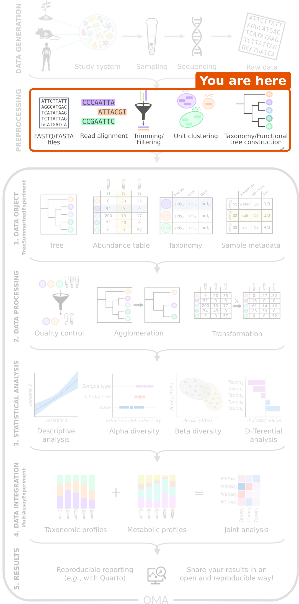

:::::::::::::::::::::::::::::::::::::: questions

- Where do the samples come from, and what should we keep in mind about them?
- How do sequencing reads become the tables that we analyse in R?
- How do I import the output of these pipelines into R?

::::::::::::::::::::::::::::::::::::::::::::::::

::::::::::::::::::::::::::::::::::::: objectives

- Name steps of data generation that can affect the results, such as sample storage, DNA extraction and batches.
- Describe the main steps of amplicon and shotgun pre-processing pipelines.
- Match the outputs of a pipeline to the parts of a `TreeSummarizedExperiment`.
- Choose the mia function that imports the output of a given pipeline.

::::::::::::::::::::::::::::::::::::::::::::::::

## Where are we?

```{r workflow, echo=FALSE, out.width="40%", fig.alt="Microbiome data science workflow with the preprocessing step highlighted: FASTQ files, read alignment, trimming and filtering, unit clustering, and taxonomy and tree construction."}

```

Before any analysis in R, samples must be collected and sequenced
(**data generation**), and the raw sequencing reads must be turned into tables
(**pre-processing**). Pre-processing is usually run on the command line, with
tools made for this purpose. The R/Bioconductor packages of the OMA framework
start *after* these steps, from the tables.

In this lesson, these steps have already been done for us. This short
episode explains what happens to the samples before we receive the data, what
to keep in mind about it, and how you can bring the output of your own
pipeline into R.

## Data generation: from a sample to reads

The analysis can only be as good as the samples. Many choices are made before
any data reaches R, and each of them can leave a mark on the data:

- **Study design.** Which groups are compared, and how many samples are
  collected? Information about the samples, such as age, diet, medication
  (especially antibiotics) and place of living, is collected at the same
  time. We need it later to interpret the results.
- **Sampling and storage.** How a sample is collected, how long it waits at
  room temperature and how it is stored (for example frozen) can change its
  microbial composition.
- **DNA extraction and library preparation.** The DNA is extracted from the
  sample and prepared for sequencing. Extraction kits differ, for example in
  how well they break open different bacteria, so the same sample can give
  different compositions with different kits.
- **Batches.** Samples are often processed and sequenced in batches. Samples
  of the same batch tend to be more similar to each other (a *batch effect*).
  If all samples of one study group are in one batch, the batch and the group
  cannot be told apart. Mixing the groups across batches avoids this.
- **Controls.** *Negative controls* (samples without any material) reveal
  contamination from the lab and the reagents. This matters most for samples
  with few bacteria, such as skin or tissue. *Positive controls* (mock
  communities with known composition) show how accurate the whole process is.

Finally, a sequencer reads short pieces of DNA, called **reads**, and writes
them into **FASTQ** files: one sequence and its quality scores per read. A
single sample typically gives tens of thousands (amplicon) to tens of
millions (shotgun) of reads.

In our study, stool samples were collected from people with colorectal cancer
and healthy people in two places in India, and sequenced with shotgun
metagenomics ([Gupta et al. 2019](https://doi.org/10.1128/mSystems.00438-19)).
The paper describes how the samples were collected and processed. When you
analyse a dataset, always read this part of the methods: it tells you which
variables, such as batches or locations, you may need to take into account.

## Pre-processing: from reads to tables

The reads are not yet a table of taxa; a pipeline must first find out which
organism each read comes from.

| | Amplicon sequencing (e.g. 16S rRNA) | Shotgun metagenomics |
|---|---|---|
| What is sequenced | One marker gene | All DNA in the sample |
| Main steps | Quality control and trimming → grouping reads into *ASVs* or *OTUs* → assigning taxonomy with a reference database (e.g. SILVA, GTDB) → building a tree | Quality control → removing host (human) reads → taxonomic profiling with marker genes → functional profiling |
| Common tools | DADA2, QIIME 2, mothur | MetaPhlAn (taxa), HUMAnN (genes and pathways) |

**ASVs** (amplicon sequence variants) are groups of identical reads, and
**OTUs** (operational taxonomic units) are groups of very similar reads. In
amplicon data, they are the rows of the abundance table, in the same way as
the species are the rows in our data.

DADA2 is itself a Bioconductor package, so amplicon pre-processing can also
be done in R. Shotgun tools such as MetaPhlAn and HUMAnN run on the command
line.

### What are the numbers in the table?

To find out which taxon a read (or an ASV) comes from, the pipeline compares
its sequence with a reference database of known sequences. The reads assigned
to each taxon are then summarized per sample. Depending on the tool, the
abundance table holds the number of reads of each taxon, or each taxon's
share of the sample (relative abundance).

Whatever the tool, the numbers tell us about the *sequenced DNA*, not
directly about the number of bacteria in the gut. The total of a sample
depends on how deeply it was sequenced. This is why we transform the data
before comparing samples ([episode 5](05-explore-prepare.Rmd)).

::::::::::::::::::::::::::::::::::::: challenge

## Challenge 1: From samples to tables

1. Put these steps of an amplicon pipeline in order: *assign taxonomy*,
   *quality control and trimming*, *build a tree*, *group reads into ASVs*.
2. You open a shotgun abundance table and see that every column sums to 100.
   What kind of numbers does it hold? Can you tell from the table how many
   reads each sample had?
3. In a study, all samples of patients were sent to the sequencing facility
   in January and all samples of healthy controls in March. In March, the
   facility switched to a new DNA extraction kit. What could go wrong in the
   analysis?

:::::::::::::::::::::::: solution

1. Quality control and trimming → group reads into ASVs → assign taxonomy →
   build a tree.
2. Relative abundances, in percent. No: the number of reads is not visible.
   You need it from elsewhere, for example the sample information.
3. The extraction kit (a batch effect) and the study group are mixed up. Any
   difference between patients and controls could be caused by the kit, and
   no analysis can tell the two apart afterwards. Mixing the groups across
   batches when the samples are processed avoids this.

:::::::::::::::::::::::::::::::::
::::::::::::::::::::::::::::::::::::::::::::::::

## Where do the outputs go in R?

In R, we store all outputs of a pipeline in one object of the
`TreeSummarizedExperiment` class (TreeSE for short), which we build in
[episode 4](04-import-treese.Rmd). It has a place for each output:

- `assay`: the abundance table, with taxa as rows and samples as columns.
- `rowData`: information about the rows (taxa), such as the taxonomy.
- `colData`: information about the columns (samples).
- `rowTree`: a tree that connects the rows.

::::::::::::::::::::::::::::::::::::: challenge

## Challenge 2: Where does each output go?

A colleague ran an amplicon pipeline and sent you these files. In which part
of a `TreeSummarizedExperiment` (`assay`, `rowData`, `colData` or `rowTree`)
would each one go?

1. A table with the number of reads of each ASV in each sample.
2. A table that gives the phylum, family and genus of each ASV.
3. A spreadsheet with the age, sex and treatment group of each mouse.
4. A Newick file that describes how the ASVs are related.
5. A file with the raw reads of each sample (FASTQ).

:::::::::::::::::::::::: solution

1. `assay`: the abundance table, with ASVs as rows and samples as columns.
2. `rowData`: information about the rows (taxa).
3. `colData`: information about the columns (samples).
4. `rowTree`: the phylogenetic tree of the rows.
5. Nowhere. Raw reads are the *input* of the pipeline; the TreeSE holds its
   *output*.

:::::::::::::::::::::::::::::::::
::::::::::::::::::::::::::::::::::::::::::::::::

## Importing pipeline output into R

In [episode 4](04-import-treese.Rmd), we build a TreeSE from plain tables,
so that we see each part. For the output of the common pipelines, the mia
package has ready-made functions that build the TreeSE directly:

| Source | Function |
|---|---|
| QIIME 2 (`.qza` files) | `importQIIME2()` |
| DADA2 (in R) | `convertFromDADA2()` |
| mothur | `importMothur()` |
| BIOM files | `importBIOM()` |
| MetaPhlAn | `importMetaPhlAn()` |
| HUMAnN | `importHUMAnN()` |
| taxpasta (standardized output of many shotgun profilers) | `importTaxpasta()` |
| phyloseq objects | `convertFromPhyloseq()` |

For example, importing a MetaPhlAn table or a QIIME 2 feature table looks like
this (the file names are placeholders):

```{r import-examples, eval=FALSE}
tse <- importMetaPhlAn(file.path("data", "metaphlan_merged.txt"))

tse <- importQIIME2(
    assay.file = file.path("data", "table.qza"),
    row.file = file.path("data", "taxonomy.qza"),
    col.file = file.path("data", "sample-metadata.tsv"),
    tree.file = file.path("data", "rooted-tree.qza")
)
```

Many public shotgun datasets, including the one used in this lesson, are
also available as TreeSE objects directly from the
[curatedMetagenomicData](https://bioconductor.org/packages/curatedMetagenomicData/)
package.

::::::::::::::::::::::::::::::::::::: challenge

## Challenge 3: Which import function?

Which function would you use in each case?

1. You received a `.biom` file from a sequencing facility.
2. Your previous analysis was done with the phyloseq package, and you have the
   phyloseq object saved in an `.rds` file.
3. You profiled shotgun samples with MetaPhlAn and merged the outputs into one
   table.
4. You profiled the same shotgun samples with HUMAnN to get pathway
   abundances.

:::::::::::::::::::::::: solution

1. `importBIOM()`.
2. Read the object with `readRDS()`, then convert it with
   `convertFromPhyloseq()`.
3. `importMetaPhlAn()`.
4. `importHUMAnN()`. The pathways describe the same samples but different
   features, so they form a second table. Combining several tables is the
   topic of the [multi-omics lesson](https://microbiome.github.io/multiomics-lesson/).

:::::::::::::::::::::::::::::::::
::::::::::::::::::::::::::::::::::::::::::::::::

::::::::::::::::::::::::::::::::::::: callout

## Learn more

See the
[Import chapter of OMA](https://bioconductor.org/books/release/OMA/pages/import.html)
for complete examples with each import function.

:::::::::::::::::::::::::::::::::::::::::::::::

::::::::::::::::::::::::::::::::::::: keypoints

- Choices made during data generation, such as sample storage, DNA extraction and batches, leave a mark on the data. Read how the samples were collected and processed before you analyse them.
- Pre-processing turns raw reads (FASTQ files) into tables of taxa. It is usually done outside R, before the analysis that this lesson covers.
- The numbers in the abundance table describe the sequenced DNA, and their total depends on the sequencing depth.
- The outputs go into the parts of a TreeSE: the abundance table into `assay`, the taxonomy into `rowData`, the sample information into `colData` and the tree into `rowTree`.
- mia has import functions, such as `importQIIME2()`, `importMetaPhlAn()` and `convertFromPhyloseq()`, that build a TreeSE directly from pipeline output.

::::::::::::::::::::::::::::::::::::::::::::::::
