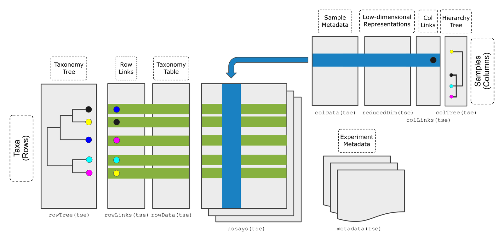

:::::::::::::::::::::::::::::::::::::: questions

- How do we load microbiome data into R?
- Why do we store the data in a single object?
- What is in our study data?

::::::::::::::::::::::::::::::::::::::::::::::::

::::::::::::::::::::::::::::::::::::: objectives

- Create a `TreeSummarizedExperiment` object from an abundance table, a taxonomy table, sample information and a tree.
- Access the abundance table, the taxonomy and the sample information of the object.
- Select a subset of the samples.
- Plot how many samples are in each study group.

::::::::::::::::::::::::::::::::::::::::::::::::

```{r setup, include=FALSE}
source("download_data.R")
```

## Where are we?

```{r workflow, echo=FALSE, out.width="40%", fig.alt="Microbiome data science workflow with the data object step highlighted: the tree, abundance table, taxonomy and sample metadata are combined into one object."}
knitr::include_graphics("fig/workflow-import.png")
```

The sequencing reads of our study have already been turned into tables. In
this episode, we bring these tables into R and combine them into a single
**data object**. All later steps start from this object.

## Load packages

```{r load-packages, message=FALSE, warning=FALSE}
library(mia)
library(miaViz)
```

## Read the data files

We start by reading the four files from [episode 3](03-setup.Rmd) into R.
The first column of each CSV file contains the row names, so we use
`row.names = 1`.

```{r read-files}
counts  <- read.csv(file.path("data", "taxonomy_abundance.csv"), row.names = 1)
taxa    <- read.csv(file.path("data", "taxonomy_table.csv"), row.names = 1)
samples <- read.csv(file.path("data", "sample_metadata.csv"), row.names = 1)
tree    <- ape::read.tree(file.path("data", "phylogeny.tree"))
```

Let's take a quick look at each of them. The abundance table has one row per
taxon and one column per sample. The row names start with the taxonomic rank
of the taxon, such as `species-`, and the column names are sample IDs:

```{r look-counts}
dim(counts)
counts[1:3, 1:3]
```

The taxonomy table has one row per taxon:

```{r look-taxa}
head(taxa, n = 3)
```

The sample information has one row per sample:

```{r look-samples}
samples[1:3, c("disease", "age", "gender", "location")]
```

And the tree connects the taxa:

```{r look-tree}
tree
```

The tree is a reference tree from MetaPhlAn, the tool that produced our
tables. It contains `r ape::Ntip(tree)` species, many more than the
`r nrow(counts)` in our data. That is fine: each of our taxa has a tip with
the same name in the tree, and this is how R knows which tip belongs to which
taxon. The printout shows the first few tip labels, which belong to species
that are not in our data.

## Why put everything into one object?

We now have four separate objects that describe the same data. This is risky:
if we remove a sample from the abundance table, we have to remember to remove
it from the sample information too. If we forget, the tables no longer match,
and our results will be wrong without any warning.

The solution is to store everything in a single object that keeps the parts
in sync. In Bioconductor, microbiome data is stored in a
**`TreeSummarizedExperiment`** (TreeSE for short).

```{r treese-figure, echo=FALSE, out.width="80%", fig.alt="Schematic of a TreeSummarizedExperiment. The assays (abundance tables) are in the middle, with taxa as rows and samples as columns. On the left are the taxonomy tree (rowTree), row links and taxonomy table (rowData). At the top right are the sample metadata (colData), low-dimensional representations (reducedDim), column links and a hierarchy tree for the samples (colTree). Experiment metadata (metadata) is at the bottom right."}

```

*Figure: the TreeSummarizedExperiment class (Huang et al. 2021, F1000Research). Source: [OMA](https://bioconductor.org/books/release/OMA/).*

The figure shows all the parts a TreeSE can hold. In this lesson, we only need
these four:

| Part | Contains | In our data |
|---|---|---|
| `assays` | The abundance tables. **Rows are taxa, columns are samples.** | Read counts |
| `rowData` | Information about the rows (taxa) | Taxonomy |
| `colData` | Information about the columns (samples) | Disease, age, gender, location, ... |
| `rowTree` | A tree that connects the rows | Phylogenetic tree |

::::::::::::::::::::::::::::::::::::: callout

## TreeSE and SummarizedExperiment

If you have used the `SummarizedExperiment` class before, for example in the
[Introduction to data analysis with R and Bioconductor](https://carpentries-incubator.github.io/bioc-intro/)
lesson: a TreeSE is a `SummarizedExperiment` with extra room for trees.
Everything you know about `SummarizedExperiment` also works for TreeSE. The
only difference in our data is what the rows are: genes in that lesson, taxa
here. The functions `assay()`, `rowData()` and `colData()` and subsetting
with `[ , ]` work exactly as you learned there.

:::::::::::::::::::::::::::::::::::::::::::::::

## Create the TreeSE

We combine the four parts with the function `TreeSummarizedExperiment()`.
The abundance table must be a matrix, so we convert it with `as.matrix()`.
We also give the data a name with `mainExpName`. This becomes useful in
the bonus section of the next episode, where we store the data at several
taxonomic ranks in the same object.

```{r create-tse}
tse <- TreeSummarizedExperiment(
    assays  = list(counts = as.matrix(counts)),
    rowData = taxa,
    colData = samples,
    rowTree = tree,
    mainExpName = "main"
)
tse
```

The printout summarizes the object:

- `dim`: `r nrow(tse)` taxa (rows) and `r ncol(tse)` samples (columns).
- `assays(1): counts`: one abundance table, named `counts`.
- `rowData names(`r ncol(rowData(tse))`)`: the taxonomy columns.
- `colData names(`r ncol(colData(tse))`)`: the columns of sample information.
- `rowTree`: the phylogenetic tree.

## Look inside the TreeSE

Each part has its own *accessor function*.

The abundance table is accessed with `assay()`:

```{r access-assay}
assay(tse, "counts")[1:3, 1:3]
```

The taxonomy is accessed with `rowData()`:

```{r access-rowdata}
rowData(tse)
```

The sample information is accessed with `colData()`:

```{r access-coldata}
colData(tse)
```

A single column of the sample information can be accessed with `$`, just as
in a data frame:

```{r access-dollar}
table(tse$disease)
```

`rowData()` and `colData()` return a `DataFrame`, the Bioconductor version of
a data frame. It works like a `data.frame`, but prints only the first and
last rows. The tree is accessed with `rowTree(tse)`. We do not need to look
at it now: functions that use the tree, such as phylogenetic diversity in
[episode 6](06-alpha-diversity.Rmd), find it there on their own.

::::::::::::::::::::::::::::::::::::: challenge

## Challenge 1: Where is the information?

In which part of `tse` would you find the age of each person?

a) `assay(tse, "counts")`
b) `rowData(tse)`
c) `colData(tse)`
d) `rowTree(tse)`

:::::::::::::::::::::::: solution

c) `colData(tse)`. Age describes a sample (a person), and information about
samples is stored in `colData`. You can get the ages with `tse$age`.

:::::::::::::::::::::::::::::::::
::::::::::::::::::::::::::::::::::::::::::::::::

::::::::::::::::::::::::::::::::::::: challenge

## Challenge 2: Which phylum?

Find out which phylum the first taxon in `tse` belongs to.

*Hint: the taxonomy is in `rowData(tse)`, and its columns are named
`superkingdom`, `phylum`, `class`, ...*

:::::::::::::::::::::::: solution

```{r challenge-phylum}
rownames(tse)[1]
rowData(tse)$phylum[1]
```

:::::::::::::::::::::::::::::::::
::::::::::::::::::::::::::::::::::::::::::::::::

## Select a subset of samples

A TreeSE can be subset with square brackets `[rows, columns]`, just like a
data frame. Rows are taxa and columns are samples. To keep only the samples
from people with CRC, we select the columns where `disease` is `"CRC"`:

```{r subset-crc}
tse_crc <- tse[, tse$disease == "CRC"]
tse_crc
```

**Result:** the new object has `r ncol(tse_crc)` samples. The abundance table
and the sample information were subset together, so they still match. This is
the main reason we use a TreeSE.

::::::::::::::::::::::::::::::::::::: challenge

## Challenge 3: Healthy people only

1. Create an object `tse_healthy` that contains only the samples from healthy
   people.
2. How many samples does it have?

:::::::::::::::::::::::: solution

```{r challenge-healthy}
tse_healthy <- tse[, tse$disease == "healthy"]
ncol(tse_healthy)
```

:::::::::::::::::::::::::::::::::
::::::::::::::::::::::::::::::::::::::::::::::::

## A first look at the study

Before any analysis, it is good to know who is in the study. The miaViz
function `plotBarplot()` counts the samples in each group of a `colData`
column (`col.var`):

```{r plot-disease, fig.alt="Bar plot of the number of samples by disease: 30 CRC and 30 healthy."}
plotBarplot(tse, col.var = "disease")
```

**Result:** the study has `r sum(tse$disease == "CRC")` people with CRC and
`r sum(tse$disease == "healthy")` healthy people.

The people come from two places: the city of Bhopal and the state of Kerala.
With `fill.by`, we can colour the bars by a
second variable:

```{r plot-location, fig.alt="Bar plot of the number of samples by location, coloured by disease. In Bhopal there are 15 CRC and 26 healthy samples; in Kerala there are 15 CRC and 4 healthy samples."}
plotBarplot(tse, col.var = "location", fill.by = "disease")
```

::::::::::::::::::::::::::::::::::::: challenge

## Challenge 4: What do you notice?

Look at the plot above.

1. From which location do most of the healthy people come?
2. Suppose we find that the microbiome of CRC patients differs from that of
   healthy people. Why could this be a problem?

:::::::::::::::::::::::: solution

1. Most healthy people come from Bhopal, while the CRC patients come equally
   from both places. You can check the numbers with
   `table(tse$location, tse$disease)`.
2. Diet and lifestyle differ between the places, and they affect the gut
   microbiome. A difference between CRC and healthy people could therefore be
   partly a difference between the two places. We will take this into account in
   the episodes on beta diversity and differential abundance.

:::::::::::::::::::::::::::::::::
::::::::::::::::::::::::::::::::::::::::::::::::

## Save the object

We save the TreeSE so that we can load it again in the next episode, without
repeating the import steps.

```{r save-tse}
saveRDS(tse, file.path("data", "tse.rds"))
```

::::::::::::::::::::::::::::::::::::: callout

## Importing your own data

In this lesson, we built the TreeSE from plain tables. Your own data probably
comes from a tool such as QIIME 2, MetaPhlAn or mothur, or is stored as a
phyloseq object. The mia package has functions that import these formats
directly into a TreeSE. See the
[Import chapter of OMA](https://bioconductor.org/books/release/OMA/pages/import.html).

:::::::::::::::::::::::::::::::::::::::::::::::

::::::::::::::::::::::::::::::::::::: keypoints

- A `TreeSummarizedExperiment` keeps the abundance table, taxonomy, sample information and tree together and in sync.
- Rows are taxa and columns are samples.
- `assay()`, `rowData()` and `colData()` access the abundance table, the taxonomy and the sample information.
- Subsetting with `[rows, columns]` keeps all parts of the object in sync.
- `plotBarplot()` gives a quick overview of the study groups. In our study, the groups differ in more than disease: most healthy people come from Bhopal.

::::::::::::::::::::::::::::::::::::::::::::::::
