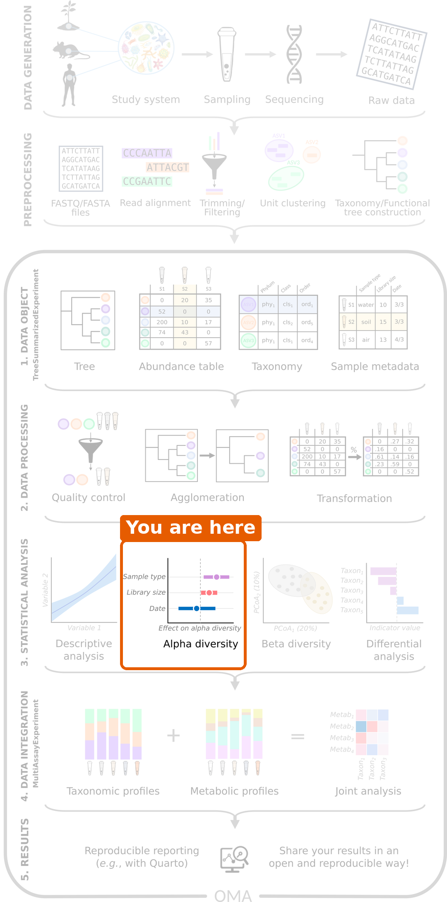

:::::::::::::::::::::::::::::::::::::: questions

- What is alpha diversity?
- How do we calculate alpha diversity?
- Does alpha diversity differ between people with colorectal cancer and healthy people?

::::::::::::::::::::::::::::::::::::::::::::::::

::::::::::::::::::::::::::::::::::::: objectives

- Explain the difference between richness, evenness and diversity.
- Calculate alpha diversity indices with `addAlpha()`.
- Plot alpha diversity by study group.
- Test whether alpha diversity differs between two groups with the Wilcoxon test, and interpret the result.

::::::::::::::::::::::::::::::::::::::::::::::::

```{r setup, include=FALSE}
source("download_data.R")
```

## Where are we?

```{r workflow, echo=FALSE, out.width="40%", fig.alt="Microbiome data science workflow with alpha diversity highlighted in the statistical analysis step."}

```

Our data is imported and processed. Now we start the **statistical analysis**
that answers our research question. The first question is: *do people with
CRC and healthy people differ in the diversity of their gut microbiome?*

## Load packages and data

```{r load-packages, message=FALSE, warning=FALSE}
library(mia)
library(miaViz)
```

```{r load-data}
tse <- readRDS(file.path("data", "tse_processed.rds"))
```

## What is alpha diversity?

**Alpha diversity** describes the diversity *within* one sample. Imagine two
gardens with the same ten kinds of flowers:

- In garden A, all ten kinds are equally common.
- In garden B, one kind makes up 91 % of all flowers, and the other nine are rare.

In the picture below, each point is one flower and each colour is one kind:

```{r gardens, echo=FALSE, fig.height=3.5, fig.width=7, fig.alt="Two gardens drawn as squares with 100 flowers each, one coloured point per flower. Garden A has ten colours, each used for ten flowers, mixed evenly. Garden B has the same ten colours, but 91 flowers share one colour and each of the other nine colours appears only once."}
library(ggplot2)
set.seed(1)
kinds <- paste("Kind", 1:10)
gardens <- data.frame(
    garden = rep(c("Garden A", "Garden B"), each = 100),
    kind = factor(c(rep(kinds, each = 10), rep(kinds[1], 91), kinds[2:10]),
                  levels = kinds),
    x = runif(200),
    y = runif(200)
)
ggplot(gardens, aes(x = x, y = y, colour = kind)) +
    geom_point(size = 4, shape = 8, stroke = 1.2) +
    facet_wrap(~ garden) +
    scale_colour_manual(
        values = RColorBrewer::brewer.pal(10, "Paired")[c(6, 1:5, 7:10)]
    ) +
    coord_fixed() +
    theme_void() +
    theme(legend.position = "none",
          strip.text = element_text(size = 13, margin = margin(b = 5)),
          panel.background = element_rect(fill = "#eef6e8", colour = NA),
          panel.spacing = unit(1, "cm"),
          plot.background = element_rect(fill = "white", colour = NA))
```

Both gardens have the same number of flower kinds, but garden A feels more
diverse. Alpha diversity captures this with different measures, called
**indices**:

| Index | Question it answers | Values |
|---|---|---|
| **Richness** (observed richness) | *How many* different taxa are there? | The number of taxa |
| **Evenness** (Pielou's evenness) | Are the taxa *equally common*, or do a few dominate? | From 0 (one taxon dominates) to 1 (all equally common) |
| **Diversity** (Shannon index) | Combines richness and evenness into one number. | From 0 upwards; typically 1–5 in gut samples |
| **Phylogenetic diversity** (Faith's index) | How much of the *tree of life* do the taxa cover? | The total branch length of the tree |

For all indices, a higher value means a more diverse sample.

These indices give **complementary** information. Two samples can have the
same richness but a different evenness, as in the gardens above, or the same
Shannon diversity for different reasons. Phylogenetic diversity adds whether
the taxa are close relatives or come from distant branches of the tree. It is
therefore good practice to look at several indices, not only one.

::::::::::::::::::::::::::::::::::::: challenge

## Challenge 1: What does alpha diversity measure?

a) The diversity between different habitats  
b) The diversity within a single community or habitat  
c) The total number of ecosystems in a region

:::::::::::::::::::::::: solution

b) The diversity within a single community or habitat. The differences
*between* communities are called beta diversity, the topic of the next
episode.

:::::::::::::::::::::::::::::::::
::::::::::::::::::::::::::::::::::::::::::::::::

::::::::::::::::::::::::::::::::::::: challenge

## Challenge 2: Two gardens

Look at gardens A and B in the figure above.

1. Which garden has the higher richness?
2. Which garden has the higher evenness?
3. Which garden has the higher Shannon diversity?

:::::::::::::::::::::::: solution

1. Neither: both have ten kinds of flowers, so the richness is the same.
2. Garden A, because all kinds are equally common.
3. Garden A. Shannon diversity combines richness and evenness, and garden A
   has the same richness but a higher evenness.

:::::::::::::::::::::::::::::::::
::::::::::::::::::::::::::::::::::::::::::::::::

## Calculate alpha diversity

The function `addAlpha()` calculates alpha diversity indices from the counts.
The transformations of the previous episode are not needed here. We choose
the indices with the `index` argument:

```{r add-alpha}
tse <- addAlpha(
    tse, assay.type = "counts",
    index = c(
        "observed_richness", "pielou_evenness",
        "shannon_diversity", "faith_diversity"
    )
)
```

The results are added as new columns to `colData`, next to the other sample
information:

```{r show-alpha}
colData(tse)[, c(
    "disease", "observed_richness", "pielou_evenness",
    "shannon_diversity", "faith_diversity"
)]
```

Faith's index needs the phylogenetic tree, which `addAlpha()` finds in the
`rowTree` of the TreeSE.

## Plot alpha diversity

The miaViz function `plotBoxplot()` shows the values of a `colData` column
(`col.var`) for each group (`x`):

```{r plot-shannon, fig.alt="Box plot of Shannon diversity by disease group. CRC samples have higher Shannon diversity than healthy samples."}
plotBoxplot(tse, col.var = "shannon_diversity", x = "disease")
```

Each point is one person. The Shannon diversity appears higher in the CRC
group. But is the difference larger than we would expect by chance?

## Compare the groups with a statistical test

To compare two groups, we use the **Wilcoxon test** (also called the
Mann–Whitney test). It sorts all values from smallest to largest and checks
whether the values of one group tend to rank higher than those of the other.
Because it uses only the order of the values, it does not assume that they
follow a normal distribution, and a few extreme values do not distort it.
This makes it a safe choice for diversity indices, which are often skewed.
For more than two groups, the Kruskal–Wallis test (`kruskal.test()`) works in
the same way.

The test gives a **p-value**: the probability of seeing a difference at least
this large if the two groups did not really differ. In this lesson, we call a
result *significant* when p < 0.05.

We run the test with `daa::getWilcoxonTest()` from the daa package. As
explained in the [setup episode](03-setup.Rmd), we write `daa::` in front of
its functions instead of loading the package. The formula reads "Shannon
diversity by disease group". The left side can be a column of `colData`, as
here, or an assay, as we will see in the differential abundance episode.

```{r wilcox-shannon, message=FALSE}
shannon_test <- daa::getWilcoxonTest(tse, shannon_diversity ~ disease)
shannon_test
```

```{r shannon-medians, include=FALSE}
shannon_median <- round(tapply(tse$shannon_diversity, tse$disease, median), 2)
```

**Result:** the median Shannon diversity is `r shannon_median[["CRC"]]` in
people with CRC and `r shannon_median[["healthy"]]` in healthy people. The
p-value is `r format(signif(shannon_test$p, 2))`, so the difference is very
unlikely to be due to chance. **People with CRC have a higher Shannon
diversity than healthy people.**

::::::::::::::::::::::::::::::::::::: challenge

## Challenge 3: Richness

1. Plot the observed richness by disease group.
2. Test whether the richness differs between the groups.
3. Which group has more species?

:::::::::::::::::::::::: solution

```{r challenge-richness, fig.alt="Box plot of observed richness by disease group. CRC samples have more species than healthy samples."}
plotBoxplot(tse, col.var = "observed_richness", x = "disease")
richness_test <- daa::getWilcoxonTest(tse, observed_richness ~ disease)
richness_test
```

People with CRC have more species in their gut sample than healthy people
(p = `r format(signif(richness_test$p, 2))`).

:::::::::::::::::::::::::::::::::
::::::::::::::::::::::::::::::::::::::::::::::::

## Is higher diversity healthier?

A more diverse gut microbiome is often described as a healthy one. Why, then,
is diversity *lower* in the healthy people of our study? Evenness gives a
clue.

```{r evenness-numbers, include=FALSE}
evenness_test <- daa::getWilcoxonTest(tse, pielou_evenness ~ disease)
evenness_median <- round(tapply(tse$pielou_evenness, tse$disease, median), 2)
```

::::::::::::::::::::::::::::::::::::: challenge

## Challenge 4: Evenness

1. Plot Pielou's evenness by disease group. Which group is less even?
2. Think back to the previous episode: which species makes up about half of
   the community in many healthy people?
3. Use your answers to explain why healthy people have a lower Shannon
   diversity.

:::::::::::::::::::::::: solution

```{r challenge-evenness, fig.alt="Box plot of Pielou's evenness by disease group. Healthy samples are less even than CRC samples."}
plotBoxplot(tse, col.var = "pielou_evenness", x = "disease")
```

1. Healthy samples are less even.
2. *Prevotella copri*.
3. When one species takes up a large part of the community, the community is
   uneven, like garden B. A low evenness gives a low Shannon diversity.

So "higher diversity" does not automatically mean "healthier". Diet,
geography and lifestyle shape the gut microbiome, and *Prevotella*-dominated
guts are common in many non-Western populations. Always interpret diversity in
the context of the study.

:::::::::::::::::::::::::::::::::
::::::::::::::::::::::::::::::::::::::::::::::::

**Result:** the median evenness is `r evenness_median[["healthy"]]` in
healthy people and `r evenness_median[["CRC"]]` in people with CRC
(p = `r format(signif(evenness_test$p, 2))`). The lower Shannon
diversity of healthy people is largely due to their lower evenness: in many of
them, one species dominates. Richness is higher in CRC too, so evenness is not
the whole story. We will see in the next episodes which taxa differ between
the groups.

::::::::::::::::::::::::::::::::::::: challenge

## Challenge 5: Phylogenetic diversity

1. Does Faith's phylogenetic diversity differ between the groups? Plot it and
   run the test.
2. Which part of the TreeSE does this index use that the other indices do not?

:::::::::::::::::::::::: solution

```{r challenge-faith, fig.alt="Box plot of Faith's phylogenetic diversity by disease group. CRC samples have higher values."}
plotBoxplot(tse, col.var = "faith_diversity", x = "disease")
faith_test <- daa::getWilcoxonTest(tse, faith_diversity ~ disease)
faith_test
```

1. Yes, it is higher in CRC (p = `r format(signif(faith_test$p, 2))`).
2. The phylogenetic tree (`rowTree`). Faith's index measures the total branch
   length of the tree covered by the taxa in a sample.

:::::::::::::::::::::::::::::::::
::::::::::::::::::::::::::::::::::::::::::::::::

```{r depth-numbers, include=FALSE}
depth_test <- cor.test(tse$library_size, tse$observed_richness,
                       method = "spearman", exact = FALSE)
depth_group_test <- daa::getWilcoxonTest(tse, library_size ~ disease)
```

::::::::::::::::::::::::::::::::::::: callout

## Sequencing depth and rarefaction

The deeper a sample is sequenced, the more rare taxa we find, so richness
partly depends on the library size. This is often checked with *rarefaction
curves*, or by randomly subsampling all samples to the same number of reads
(*rarefying*). This applies to both amplicon and shotgun data; `addAlpha()`
can rarefy with its `sample` and `niter` arguments.

Rarefying throws data away, and whether to do it is debated. A simple first
check is whether richness is related to the library size. In our data, it is
not clearly related (Spearman correlation
rho = `r round(depth_test$estimate, 2)`,
p = `r format(signif(depth_test$p.value, 2))`), and the library sizes do not
differ between the groups
(p = `r format(signif(depth_group_test$p, 2))`), so we do not rarefy
here. See the
[Alpha diversity chapter of OMA](https://bioconductor.org/books/release/OMA/pages/alpha_diversity.html).

:::::::::::::::::::::::::::::::::::::::::::::::

::::::::::::::::::::::::::::::::::::: challenge

## Challenge 6: Diversity, age and gender (30 minutes)

Disease is not the only thing we know about the people in our study. Is
diversity also related to their age or gender?

1. Does the Shannon diversity differ between women and men? Make the plot
   and run the test.
2. Is the Shannon diversity related to age? Use a correlation test:
   `cor.test(tse$age, tse$shannon_diversity, method = "spearman")`.
3. Plot the age of the people by disease group. What do you notice?
4. Repeat the correlation test separately for the CRC patients and for the
   healthy people. Is diversity still related to age? *Hint: subset the
   TreeSE to one group, as for any SummarizedExperiment:
   `tse[, tse$disease == "CRC"]`.*
5. Make age groups with
   `tse$age_group <- cut(tse$age, breaks = c(0, 40, 60, 100), labels = c("under 40", "40-60", "over 60"))`
   and plot the Shannon diversity by age group, coloured by disease
   (`fill.by = "disease"`).
6. Write two or three sentences: is diversity related to age in this study?

:::::::::::::::::::::::: solution

**1. Gender**

```{r challenge-gender, fig.alt="Box plot of Shannon diversity by gender. The two groups are similar."}
plotBoxplot(tse, col.var = "shannon_diversity", x = "gender")
gender_test <- daa::getWilcoxonTest(tse, shannon_diversity ~ gender)
gender_test
```

There is no clear difference between women and men
(p = `r format(signif(gender_test$p, 2))`).

**2. Age**

```{r challenge-age-cor}
age_test <- cor.test(
    tse$age, tse$shannon_diversity, method = "spearman", exact = FALSE
)
age_test
```

Older people seem to have a higher diversity
(rho = `r round(age_test$estimate, 2)`,
p = `r format(signif(age_test$p.value, 2))`).

**3. Age by disease**

```{r challenge-age-disease, fig.alt="Box plot of age by disease group. CRC patients are clearly older than healthy people."}
plotBoxplot(tse, col.var = "age", x = "disease")
```

```{r challenge-age-numbers, include=FALSE}
age_median <- tapply(tse$age, tse$disease, median)
```

The CRC patients are much older (median `r age_median[["CRC"]]` years) than
the healthy people (median `r age_median[["healthy"]]` years).

**4. Within each group**

```{r challenge-age-within}
tse_crc <- tse[, tse$disease == "CRC"]
age_test_crc <- cor.test(
    tse_crc$age, tse_crc$shannon_diversity, method = "spearman", exact = FALSE
)
age_test_crc

tse_healthy <- tse[, tse$disease == "healthy"]
age_test_healthy <- cor.test(
    tse_healthy$age, tse_healthy$shannon_diversity,
    method = "spearman", exact = FALSE
)
age_test_healthy
```

Within each group, diversity is not clearly related to age (CRC:
p = `r format(signif(age_test_crc$p.value, 2))`; healthy:
p = `r format(signif(age_test_healthy$p.value, 2))`).

**5. Age groups**

```{r challenge-age-groups, fig.alt="Box plots of Shannon diversity by age group, coloured by disease. There are no CRC patients under 40. In the two older age groups, CRC samples have higher diversity than healthy samples."}
tse$age_group <- cut(
    tse$age, breaks = c(0, 40, 60, 100),
    labels = c("under 40", "40-60", "over 60")
)
plotBoxplot(
    tse, col.var = "shannon_diversity", x = "age_group", fill.by = "disease"
)
```

The youngest age group contains only healthy people. In the two older age
groups, the CRC samples are more diverse than the healthy ones.

**6.** The link between age and diversity is most likely not a direct effect
of age: it appears because the CRC patients, who have a higher diversity, are
also older. Within each disease group, diversity is not clearly related to
age, and within the same age group, CRC patients are still more diverse. When
two variables are linked like this, it is called *confounding*
([episode 1](01-intro-microbiome.Rmd)). We will meet it again with the location in
[episode 7](07-beta-diversity.Rmd). Always check how the variables in a study
are related to each other.

:::::::::::::::::::::::::::::::::
::::::::::::::::::::::::::::::::::::::::::::::::

::::::::::::::::::::::::::::::::::::: keypoints

- Alpha diversity describes the diversity within a sample: richness (how many taxa), evenness (how equal), both (Shannon), or the share of the tree of life covered (Faith). The indices give complementary information.
- `addAlpha()` calculates diversity indices and adds them to `colData`.
- `plotBoxplot()` and `daa::getWilcoxonTest()` compare alpha diversity between two groups. The Wilcoxon test does not assume normally distributed values.
- In our study, people with CRC have a higher diversity, partly because the gut of many healthy people is dominated by one species. Higher diversity is not automatically healthier.
- Check for confounding: in our study, the CRC patients are also older than the healthy people.

::::::::::::::::::::::::::::::::::::::::::::::::
