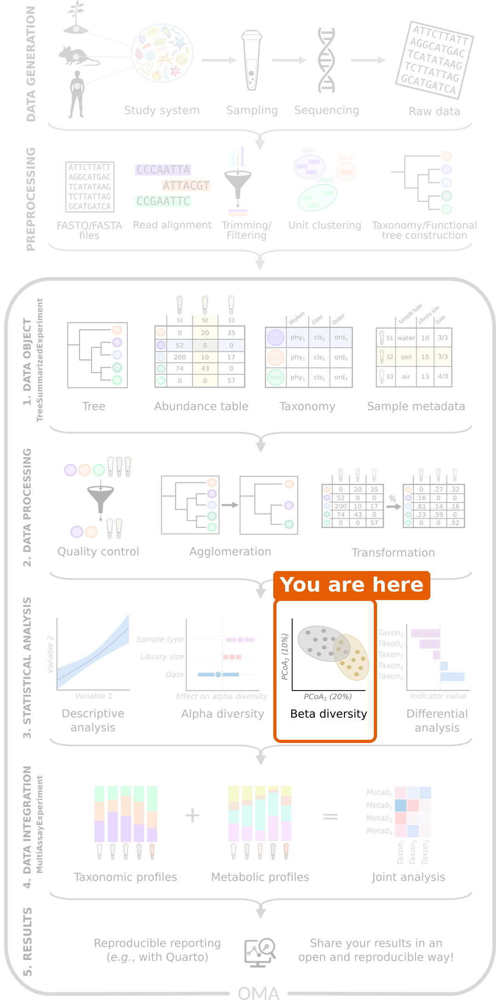

:::::::::::::::::::::::::::::::::::::: questions

- How different are the samples from each other?
- How can we visualize the differences between many samples?
- Is the community composition different between people with colorectal cancer and healthy people?
- (Bonus) Do the samples fall into natural groups?

::::::::::::::::::::::::::::::::::::::::::::::::

::::::::::::::::::::::::::::::::::::: objectives

- Explain what a dissimilarity between two samples is.
- Create and interpret ordination plots with PCoA and PCA, and explain why both are useful.
- Use the phylogenetic tree in a beta diversity analysis with UniFrac.
- Test whether groups differ in composition with PERMANOVA, check the homogeneity of the group spreads, and interpret the results.
- Account for another variable with distance-based redundancy analysis (dbRDA).
- (Bonus) Find groups of similar samples with clustering, and show them on an ordination plot.

::::::::::::::::::::::::::::::::::::::::::::::::

```{r setup, include=FALSE}
source("download_data.R")
set.seed(123)
```

## Where are we?

```{r workflow, echo=FALSE, out.width="40%", fig.alt="Microbiome data science workflow with beta diversity highlighted in the statistical analysis step."}

```

In the previous episode, we compared the diversity *within* samples. Now we
compare *whole communities* between samples: *is the overall composition of
the gut microbiome different between people with CRC and healthy people?*

## Load packages and data

```{r load-packages, message=FALSE, warning=FALSE}
library(mia)
library(miaViz)
library(scater)
```

```{r load-data}
tse <- readRDS(file.path("data", "tse_processed.rds"))
```

## What is beta diversity?

Alpha diversity summarizes each sample with a single number. **Beta
diversity** compares *whole communities*: how different is the community of
one sample from that of another?

### Dissimilarity between two samples

We measure how different two samples are with a **dissimilarity**. The most
common one in microbiome research is the **Bray–Curtis dissimilarity**. It
goes from 0 (the samples have exactly the same composition) to 1 (the samples
share no taxa at all).

Here is a small example with relative abundances of three taxa:

| | Taxon A | Taxon B | Taxon C |
|---|---|---|---|
| Sample 1 | 0.6 | 0.4 | 0.0 |
| Sample 2 | 0.2 | 0.4 | 0.4 |

For relative abundances, Bray–Curtis is half the sum of the absolute
differences: (|0.6 − 0.2| + |0.4 − 0.4| + |0.0 − 0.4|) / 2 = (0.4 + 0 + 0.4) / 2
= **0.4**.

::::::::::::::::::::::::::::::::::::: challenge

## Challenge 1: Calculate a dissimilarity

Calculate the Bray–Curtis dissimilarity between these two samples:

| | Taxon A | Taxon B | Taxon C |
|---|---|---|---|
| Sample 1 | 0.5 | 0.5 | 0.0 |
| Sample 3 | 0.0 | 0.0 | 1.0 |

What does the result mean?

:::::::::::::::::::::::: solution

(|0.5 − 0| + |0.5 − 0| + |0 − 1|) / 2 = 2 / 2 = **1**. The two samples share
no taxa, so they are as different as possible.

:::::::::::::::::::::::::::::::::
::::::::::::::::::::::::::::::::::::::::::::::::

### Ordination: a map of the samples

With `r ncol(tse)` samples, there are `r choose(ncol(tse), 2)` pairs of
samples, and so `r choose(ncol(tse), 2)` dissimilarities. That is far too many
numbers to read. An **ordination** draws a map of the samples, in which
samples that are similar are close to each other and samples that are
different are far apart.

A common ordination method is the **Principal Coordinate Analysis (PCoA)**,
also called multidimensional scaling (MDS). It finds the directions that
explain the most differences between the samples and uses them as the axes of
the map.

## PCoA with Bray–Curtis dissimilarity

The function `addMDS()` calculates the dissimilarities and the PCoA in one
step. We use the relative abundances, choose the Bray–Curtis method, and name
the result `PCoA_BC`:

```{r pcoa-bray}
tse <- addMDS(
    tse, assay.type = "relabundance", method = "bray", name = "PCoA_BC"
)
```

The result is stored in the `reducedDim` part of the TreeSE. We plot it with
the miaViz function `plotOrdination()` and colour the samples by disease:

```{r plot-pcoa-bray, fig.alt="PCoA plot based on Bray-Curtis dissimilarity, coloured by disease. Healthy samples are mostly on the right side of the first axis and CRC samples mostly on the left, with some overlap."}
plotOrdination(tse, "PCoA_BC", colour.by = "disease")
```

Each point is a sample. The axes have no units: what matters is how far apart
the points are. The first axis (`PCoA_BC1`) shows the largest differences
between the samples, the second axis the next largest.

**Result:** healthy samples mostly lie on one side of the first axis and CRC
samples on the other, although the groups overlap. The communities of CRC
patients and healthy people seem to differ.

::::::::::::::::::::::::::::::::::::: challenge

## Challenge 2: What drives the first axis?

1. Do the CRC and healthy samples separate completely?
2. Which species could be driving the separation along the first axis?
   *Hint: think back to episode 5.*
3. Check your idea: colour the points by the relative abundance of that
   species. *Hint: give the name of the species to `colour.by`, and the table
   to `assay.type`.*

:::::::::::::::::::::::: solution

1. No. Most samples fall on "their" side, but there is clear overlap. The
   microbiome differs a lot between individuals, even within one group.
2. *Prevotella copri*, which dominates many healthy samples.
3. Samples with a lot of *P. copri* lie on one side of the first axis:

```{r challenge-colour-prevotella, fig.alt="PCoA plot coloured by the relative abundance of Prevotella copri. Samples on the right side of the first axis have a high abundance of Prevotella copri."}
plotOrdination(
    tse, "PCoA_BC",
    colour.by = "species-Prevotella_copri", assay.type = "relabundance"
)
```

:::::::::::::::::::::::::::::::::
::::::::::::::::::::::::::::::::::::::::::::::::

## PCA on rclr data

**Principal Component Analysis (PCA)** is the most widely used ordination
method in data science in general. It works directly on the values of the table rather than on a dissimilarity:
its axes, the *principal components* (PC1, PC2, ...), are combinations of the
taxa. PCA works best with roughly normally distributed values, such as the
rclr table from [episode 5](05-explore-prepare.Rmd). The function `runPCA()`
from the scater package calculates it:

```{r pca}
tse <- runPCA(tse, assay.type = "rclr", name = "PCA", ncomponents = 5)
```

```{r plot-pca, fig.alt="PCA plot of rclr values, coloured by disease. Healthy samples are mostly in the upper left; CRC samples are spread over the right side and the bottom of the plot."}
plotOrdination(tse, "PCA", colour.by = "disease")
```

**Result:** the PCA also separates the two groups: the healthy samples gather
in one part of the map, while the CRC samples are more spread out. The map
looks different from the PCoA, because PCA looks at the data in a different
way.

A big advantage of PCA is that it tells us *which taxa* drive each axis. Each
taxon gets a **loading** for each axis: taxa with large positive or negative
loadings pull samples towards that end of the axis.

::::::::::::::::::::::::::::::::::::: challenge

## Challenge 3: Which taxa drive the PCA?

1. Plot the loadings of the first two axes with the miaViz function
   `plotLoadings()`. Show the 10 taxa with the largest loadings
   (`ncomponents = 2`, `n = 10`).
2. Which taxa have the largest loadings on the first axis (PC1)?
3. Compare with the PCA plot: on which side of PC1 are the healthy samples?
   Does this agree with what you know about *Prevotella copri*?

:::::::::::::::::::::::: solution

```{r challenge-loadings, fig.alt="Bar plots of the loadings of the ten most important taxa on the first two principal components."}
plotLoadings(tse, dimred = "PCA", ncomponents = 2, n = 10)
```

```{r loadings-numbers, include=FALSE}
loadings <- attr(reducedDim(tse, "PCA"), "rotation")
pc1_top <- names(sort(abs(loadings[, "PC1"]), decreasing = TRUE))[1:3]
copri_sign <- ifelse(loadings["species-Prevotella_copri", "PC1"] > 0, "positive", "negative")
```

2. The largest loadings on PC1 belong to `r paste(pc1_top, collapse = ", ")`.
3. *Prevotella copri* has a `r copri_sign` loading on PC1, so samples with a
   lot of *P. copri* lie on the `r copri_sign` side of PC1. These are mostly
   the healthy samples, which agrees with episode 5.

:::::::::::::::::::::::::::::::::
::::::::::::::::::::::::::::::::::::::::::::::::

::::::::::::::::::::::::::::::::::::: callout

## PCA and PCoA are complementary

PCoA can use any dissimilarity. Bray–Curtis on relative abundances is driven
mostly by the abundant taxa. PCA on rclr values gives more weight to changes
in rare taxa, and gives loadings that show which taxa drive the axes. (The
straight-line distance between the rclr values of two samples is called the
*robust Aitchison distance*; a PCA on rclr values gives the same map as a
PCoA with this distance.) Because the two methods look at the data
differently, they can reveal different patterns. Make both.

:::::::::::::::::::::::::::::::::::::::::::::::

## Using the tree: UniFrac

Bray–Curtis and PCA treat every taxon as unrelated to all the others. But two
species can be genetically very similar and play similar roles in the gut.
If one sample has species X and another has its close relative Y, the two
samples are more similar than if they had two distant species. Standard
distances miss this.

The **UniFrac** distance uses the phylogenetic tree to take this into
account. It measures how much of the tree's branch length is shared by two
samples. Many studies ignore the phylogeny, even when it is available, so it
is worth adding to your analyses.

`addMDS()` takes the tree from the `rowTree` of the TreeSE. By default, it
calculates the *unweighted* UniFrac, which only uses whether a taxon is
present in a sample or not:

```{r pcoa-unifrac, fig.alt="PCoA plot based on unweighted UniFrac distance, coloured by disease. Healthy samples are mostly in the upper left; CRC samples are mostly on the right and at the bottom."}
tse <- addMDS(
    tse, assay.type = "counts", method = "unifrac", name = "PCoA_UniFrac"
)
plotOrdination(tse, "PCoA_UniFrac", colour.by = "disease")
```

The warning `Pruning tree...` is harmless: the tree contains many more taxa
than our data, and it is trimmed to the taxa in the data.

**Result:** the groups also tend to separate when the relatedness of the taxa
is taken into account.

::::::::::::::::::::::::::::::::::::: challenge

## Challenge 4: Weighted UniFrac

The *weighted* UniFrac also takes the abundances of the taxa into account.

1. Make a PCoA with weighted UniFrac: add `weighted = TRUE` to `addMDS()`
   and name the result `PCoA_wUniFrac`.
2. Colour the plot by disease. Do the groups separate as clearly as with
   unweighted UniFrac?
3. Colour the plot by the relative abundance of *Prevotella copri*. What do
   you see?

:::::::::::::::::::::::: solution

```{r challenge-wunifrac, fig.alt="PCoA plot based on weighted UniFrac distance, coloured by disease. The groups overlap more than with unweighted UniFrac; many healthy samples form a tight group on the right."}
tse <- addMDS(
    tse, assay.type = "counts", method = "unifrac",
    weighted = TRUE, name = "PCoA_wUniFrac"
)
plotOrdination(tse, "PCoA_wUniFrac", colour.by = "disease")
```

```{r challenge-wunifrac-copri, fig.alt="PCoA plot based on weighted UniFrac distance, coloured by the relative abundance of Prevotella copri. Samples with a high abundance form a tight group on the right."}
plotOrdination(
    tse, "PCoA_wUniFrac",
    colour.by = "species-Prevotella_copri", assay.type = "relabundance"
)
```

2. The groups overlap more than with unweighted UniFrac.
3. The samples with a lot of *P. copri* form a tight group. Weighted UniFrac
   is driven by the most abundant taxa, so the samples dominated by
   *P. copri* look very similar to each other. Unweighted UniFrac, in
   contrast, is sensitive to rare taxa. The two versions answer different
   questions, so it is useful to look at both.

:::::::::::::::::::::::::::::::::
::::::::::::::::::::::::::::::::::::::::::::::::

::::::::::::::::::::::::::::::::::::: callout

## Which distance should I use?

Bray–Curtis is the most common choice and a good default. The robust
Aitchison distance (PCA on rclr) is designed for relative data. UniFrac uses
the phylogenetic tree. Different distances answer slightly different
questions, so it is good practice to compare a few. See the
[Community similarity chapter of OMA](https://bioconductor.org/books/release/OMA/pages/community_similarity.html).

:::::::::::::::::::::::::::::::::::::::::::::::

## Is the difference real? PERMANOVA

A plot can suggest a difference, but we need a statistical test to evaluate
it. **PERMANOVA** (permutational multivariate analysis of variance) tests
whether the centres of the groups are further apart than we would expect by
chance. It works directly on the dissimilarities.

```{r permanova}
permanova <- getPERMANOVA(
    tse, assay.type = "relabundance", method = "bray", formula = x ~ disease
)
permanova$permanova
```

```{r permanova-numbers, include=FALSE}
r2 <- permanova$permanova["disease", "R2"]
p_permanova <- permanova$permanova["disease", "Pr(>F)"]
p_homogeneity <- permanova$homogeneity["disease", "Pr(>F)"]
```

In the formula, `x` stands for the abundance table and `disease` is the
variable we test. Two numbers are important:

- **R2**: the share of the differences between samples that is explained by
  the variable.
- **Pr(>F)**: the p-value.

**Result:** disease explains `r round(100 * r2)` % of the differences between
samples (R2 = `r round(r2, 2)`), with a p-value of
`r format(signif(p_permanova, 2))`. The
communities of CRC patients and healthy people differ significantly. Still,
most of the differences between people (`r round(100 * (1 - r2))` %) are
*not* explained by the disease.

PERMANOVA is a *permutation* test: it shuffles the group labels of the
samples at random many times (999 by default) and checks how often the
shuffled groups differ as much as the real ones. With 999 permutations, the
smallest possible p-value is 0.001. Because the shuffling is random, your
p-values may differ slightly from the ones shown here.

### Check the spread of the groups

PERMANOVA assumes that the groups are about equally spread out
(*homogeneity of dispersion*). If one group is much more spread out than the
other, PERMANOVA can give a small p-value even when the group centres do not
differ. **Always test this assumption.** `getPERMANOVA()` tests it for us:

```{r homogeneity}
permanova$homogeneity
```

We can also see the centre and the spread of each group on the PCoA plot.
With `add.ellipse = TRUE`, `plotOrdination()` draws an ellipse around the
samples of each group:

```{r plot-centroids, fig.alt="Bray-Curtis PCoA plot coloured by disease, with an ellipse around each group. The centres of the two ellipses lie on opposite sides of the first axis, and the ellipse of the CRC group is larger than that of the healthy group."}
plotOrdination(tse, "PCoA_BC", colour.by = "disease", add.ellipse = TRUE)
```

**Result:** the p-value is `r format(signif(p_homogeneity, 2))`, so the groups
differ in spread. The CRC samples are more spread out, while many healthy
samples are close to each other, many of them being dominated by
*Prevotella copri*. Our PERMANOVA result is therefore partly due to the
difference in spread. The PCoA plot also shows that the group centres lie on
different sides of the first axis, so the groups differ in both their centre
and their spread. We should report both, and not the PERMANOVA p-value alone.

::::::::::::::::::::::::::::::::::::: challenge

## Challenge 5: Interpret PERMANOVA

PERMANOVA gives R2 = `r round(r2, 2)` and p = `r format(signif(p_permanova, 2))`. Which statement
is correct?

a) Disease explains `r round(100 * (1 - r2))` % of the differences between samples.
b) Disease explains a small but significant part of the differences between samples.
c) Every CRC sample is different from every healthy sample.

:::::::::::::::::::::::: solution

b) Disease explains `r round(100 * r2)` % of the differences, which is a small
part, and the result is significant. Statement a) mixes up the explained and
unexplained parts. Statement c) is wrong because the groups overlap in the
PCoA plot.

:::::::::::::::::::::::::::::::::
::::::::::::::::::::::::::::::::::::::::::::::::

## Accounting for another variable

In [episode 4](04-import-treese.Rmd), we noticed that most healthy people come
from Bhopal. Could the difference we found be a difference between the two places
instead? When another variable is linked to both the groups and the outcome,
it can *confound* the comparison ([episode 1](01-intro-microbiome.Rmd)).

::::::::::::::::::::::::::::::::::::: challenge

## Challenge 6: Colour by location

1. Plot the Bray–Curtis PCoA, coloured by `location`.
2. Compare it with the plot coloured by disease. What do you see?

:::::::::::::::::::::::: solution

```{r challenge-location, fig.alt="PCoA plot based on Bray-Curtis dissimilarity, coloured by location. Samples from Kerala are mostly on the left side of the first axis and in the lower part of the plot."}
plotOrdination(tse, "PCoA_BC", colour.by = "location")
```

The samples from Kerala are mostly on the same side of the first axis as the
CRC samples. This is expected, because most people from Kerala in this study
have CRC. Many of them also lie in the lower part of the plot, along the
second axis. From this plot alone, we cannot tell the effects of disease and
location apart.

:::::::::::::::::::::::::::::::::
::::::::::::::::::::::::::::::::::::::::::::::::

### Distance-based redundancy analysis (dbRDA)

**dbRDA** is an ordination that includes variables from `colData`. Like
PERMANOVA, it starts from the dissimilarities and uses a formula. Unlike PCoA,
its axes are chosen to show the differences that the variables explain. It
tests how much each variable explains *while taking the other variables into
account*. We add `location` to the formula:

```{r dbrda}
tse <- addRDA(
    tse, assay.type = "relabundance", method = "bray",
    formula = x ~ disease + location, name = "dbRDA"
)
```

The miaViz function `plotRDA()` shows the samples together with an arrow for
each variable. The arrow points towards the samples of the named group (for
example, `disease — healthy` points towards the healthy samples). Its label
shows how much the variable explains, and its p-value:

```{r plot-dbrda, fig.alt="dbRDA plot coloured by disease, with one arrow for disease and one for location. The labels show the share of differences each variable explains and its p-value."}
plotRDA(tse, "dbRDA", colour.by = "disease")
```

```{r dbrda-numbers, include=FALSE}
rda_table <- attr(reducedDim(tse, "dbRDA"), "significance")$permanova
rda_explained <- round(100 * rda_table[, "Explained variance"])
names(rda_explained) <- rownames(rda_table)
rda_p <- rda_table[, "Pr(>F)"]
names(rda_p) <- rownames(rda_table)
```

**Result:** disease explains `r rda_explained[["disease"]]` %
(p = `r format(signif(rda_p[["disease"]], 2))`) and location `r rda_explained[["location"]]` %
(p = `r format(signif(rda_p[["location"]], 2))`) of the differences between samples. **The
disease effect remains when the location is taken into account.** The location also
matters, so we will include it in the differential abundance analysis in the
next episode.

::::::::::::::::::::::::::::::::::::: challenge

## Challenge 7: What about age?

In [episode 6](06-alpha-diversity.Rmd), we found that the CRC patients are
older than the healthy people.

1. Run the dbRDA again with `age` added to the formula, and name the result
   `dbRDA_age`.
2. Plot it with `plotRDA()`. Does disease still explain a significant part of
   the differences? How much does age explain?

:::::::::::::::::::::::: solution

```{r challenge-dbrda-age, fig.alt="dbRDA plot coloured by disease, with arrows for disease, location and age. The labels show the share of differences each variable explains and its p-value."}
tse <- addRDA(
    tse, assay.type = "relabundance", method = "bray",
    formula = x ~ disease + location + age, name = "dbRDA_age"
)
plotRDA(tse, "dbRDA_age", colour.by = "disease")
```

```{r dbrda-age-numbers, include=FALSE}
age_table <- attr(reducedDim(tse, "dbRDA_age"), "significance")$permanova
age_explained <- round(100 * age_table[, "Explained variance"])
names(age_explained) <- rownames(age_table)
age_p <- age_table[, "Pr(>F)"]
names(age_p) <- rownames(age_table)
```

Disease now explains `r age_explained[["disease"]]` %
(p = `r format(signif(age_p[["disease"]], 2))`), and age `r age_explained[["age"]]` %
(p = `r format(signif(age_p[["age"]], 2))`). The share of disease is smaller than before, because
disease and age are linked: part of the differences can be explained by
either of them. Still, disease explains a significant part on its own, while
age adds little. Because the two are confounded, the data cannot fully tell
them apart.

:::::::::::::::::::::::::::::::::
::::::::::::::::::::::::::::::::::::::::::::::::

::::::::::::::::::::::::::::::::::::: challenge

## Challenge 8: Beta diversity at genus level (30 minutes)

In this episode, we worked at the species level. Do the results hold at the
genus level? And does gender matter?

1. Agglomerate the data to the genus level with `agglomerateByRank()`, and
   add relative abundances with `transformAssay()`.
2. Make a Bray–Curtis PCoA of the genera and colour it by disease. Does it
   look like the species-level PCoA?
3. Run PERMANOVA for disease at the genus level. How much does disease
   explain? Compare with the species level.
4. Test the homogeneity of the group spreads at the genus level. Is the
   result different from the species level? What does this mean for the
   PERMANOVA result?
5. Back at the species level: does gender explain differences in
   composition? Run PERMANOVA with `formula = x ~ gender`.

:::::::::::::::::::::::: solution

**1.–2. Genus-level PCoA**

```{r challenge-genus-pcoa, warning=FALSE, fig.alt="PCoA plot of genus-level Bray-Curtis dissimilarities, coloured by disease. CRC and healthy samples tend to separate, similar to the species-level plot."}
tse_genus <- agglomerateByRank(tse, rank = "genus")
tse_genus <- transformAssay(
    tse_genus, assay.type = "counts", method = "relabundance"
)
tse_genus <- addMDS(
    tse_genus, assay.type = "relabundance", method = "bray", name = "PCoA_BC"
)
plotOrdination(tse_genus, "PCoA_BC", colour.by = "disease")
```

As at the species level, the groups tend to separate: many healthy samples
form a tight cluster on one side. The overlap is somewhat larger.

**3.–4. Genus-level PERMANOVA**

```{r challenge-genus-permanova}
permanova_genus <- getPERMANOVA(
    tse_genus, assay.type = "relabundance", method = "bray",
    formula = x ~ disease
)
permanova_genus$permanova
permanova_genus$homogeneity
```

```{r challenge-genus-numbers, include=FALSE}
r2_genus <- permanova_genus$permanova["disease", "R2"]
p_hom_genus <- permanova_genus$homogeneity["disease", "Pr(>F)"]
```

At the genus level, disease explains `r round(100 * r2_genus)` % of the
differences (`r round(100 * r2)` % at the species level), so the effect is
somewhat smaller but still clear. The homogeneity test gives
p = `r format(signif(p_hom_genus, 2))`: at the genus level, we find **no**
evidence that the groups differ in spread. Here we can interpret the
PERMANOVA result as a difference in the group centres.

**5. Gender**

```{r challenge-gender-permanova}
permanova_gender <- getPERMANOVA(
    tse, assay.type = "relabundance", method = "bray", formula = x ~ gender
)
permanova_gender$permanova
```

```{r challenge-gender-numbers, include=FALSE}
r2_gender <- permanova_gender$permanova["gender", "R2"]
p_gender <- permanova_gender$permanova["gender", "Pr(>F)"]
```

Gender explains only `r round(100 * r2_gender)` % of the differences, and the
result is not significant (p = `r format(signif(p_gender, 2))`).

:::::::::::::::::::::::::::::::::
::::::::::::::::::::::::::::::::::::::::::::::::

## Bonus: clustering, natural groups of samples

This section is optional.

So far, we have always started from the study groups, CRC and healthy. But
would the samples fall into groups even if we did not know who has CRC?

**Clustering** sorts samples into groups, called *clusters*, so that samples
in the same cluster are similar to each other and different from the samples
in other clusters. It uses only the abundance table, not the sample
information. This is called an **unsupervised** analysis. In microbiome
research, clustering is used to find *community types*. A well-known example
are **enterotypes**: gut microbiomes are often dominated by either
*Bacteroides* or *Prevotella*.

We use **hierarchical clustering**. It starts with each sample in its own
group, and then joins the two most similar groups again and again. Here, the
similarity is the straight-line distance between the rclr values of the
samples (the robust Aitchison distance). The result
is a tree of samples, which we cut into the number of clusters we want. The
function `addCluster()` uses clustering methods from the bluster package:

```{r load-bluster, message=FALSE}
library(bluster)
```

We cluster the samples (`by = "cols"`) on their rclr values, join the groups
with Ward's method (`ward.D2`, which keeps the clusters as compact as
possible), and cut the tree into two clusters (`k = 2`):

```{r hclust}
tse <- addCluster(
    tse,
    assay.type = "rclr",
    by = "cols",
    HclustParam(method = "ward.D2", cut.params = list(k = 2))
)
table(tse$cluster)
```

The cluster of each sample is stored in the `colData` column `cluster`. We
show the clusters on the PCA, with the shape of each point showing the
disease:

```{r plot-pca-cluster, fig.alt="PCA plot of rclr values, coloured by cluster and with point shapes by disease. The two clusters occupy different parts of the plot, and most healthy samples fall in one cluster."}
plotOrdination(tse, "PCA", colour.by = "cluster", shape.by = "disease")
```

```{r cluster-numbers, include=FALSE}
cl_tab <- table(tse$cluster, tse$disease)
copri <- assay(tse, "relabundance")["species-Prevotella_copri", ]
copri_median <- round(100 * tapply(copri, tse$cluster, median))
copri_cluster <- names(which.max(copri_median))
other_cluster <- names(which.min(copri_median))
```

The clustering never saw the disease. Let's compare the clusters with the
study groups, and look at the species we have followed through the lesson:

```{r cluster-disease}
table(cluster = tse$cluster, disease = tse$disease)
```

```{r plot-copri-cluster, fig.alt="Box plot of the relative abundance of Prevotella copri by cluster. In one cluster it makes up a large part of the community; in the other it is close to zero."}
plotBoxplot(
    tse, assay.type = "relabundance",
    features = "species-Prevotella_copri", x = "cluster"
)
```

**Result:** cluster `r copri_cluster` contains
`r cl_tab[copri_cluster, "healthy"]` healthy people and
`r cl_tab[copri_cluster, "CRC"]` people with CRC, and *Prevotella copri*
makes up a median of `r copri_median[[copri_cluster]]` % of their community.
Cluster `r other_cluster` contains `r cl_tab[other_cluster, "CRC"]` people
with CRC and `r cl_tab[other_cluster, "healthy"]` healthy people, with a
median of `r copri_median[[other_cluster]]` % *P. copri*. The main structure in
our data is a ***Prevotella* community type** versus a non-*Prevotella*
type, and it is strongly linked to the disease.

::::::::::::::::::::::::::::::::::::: callout

## Cluster the data, not the ordination

Cluster the data itself: the transformed abundance table, as above, or a
dissimilarity. Do **not** cluster the PCA or PCoA axes. This is a common
mistake: the first few axes keep only part of the variation, so the clusters
would follow what the 2-D plot shows rather than the data. Use the ordination
only to *visualise* the clusters.

Clustering also always returns clusters, even when the data has no real
groups. Check whether the clusters hold up when you change the method or the
number of clusters. See the
[Clustering chapter of OMA](https://bioconductor.org/books/release/OMA/pages/clustering.html).

:::::::::::::::::::::::::::::::::::::::::::::::

::::::::::::::::::::::::::::::::::::: challenge

## Challenge 9 (bonus): K-means clustering

**K-means** is another common clustering method. It places `k` cluster
centres and assigns each sample to the nearest centre, then moves the centres
until they settle.

1. Cluster the samples with k-means and two clusters. Use
   `KmeansParam(centers = 2)` instead of `HclustParam()`, and store the result
   in a column called `kmeans` with `clust.col = "kmeans"`.
2. Compare the k-means clusters with the hierarchical clusters using
   `table()`. Do the two methods agree?
3. Try three clusters with hierarchical clustering
   (`cut.params = list(k = 3)`, `clust.col = "cluster_k3"`). Which cluster is
   split, and how are the new clusters related to the disease?

:::::::::::::::::::::::: solution

```{r challenge-kmeans}
tse <- addCluster(
    tse, assay.type = "rclr", by = "cols",
    KmeansParam(centers = 2), clust.col = "kmeans"
)
table(hclust = tse$cluster, kmeans = tse$kmeans)
```

```{r kmeans-numbers, include=FALSE}
km_tab <- table(tse$cluster, tse$kmeans)
km_agree <- max(sum(diag(km_tab)), sum(km_tab) - sum(diag(km_tab)))
```

2. The methods agree on `r km_agree` of the `r ncol(tse)` samples. The
   cluster numbers themselves are arbitrary: cluster 1 of one method may be
   cluster 2 of the other. What matters is which samples end up together.

```{r challenge-k3}
tse <- addCluster(
    tse, assay.type = "rclr", by = "cols",
    HclustParam(method = "ward.D2", cut.params = list(k = 3)),
    clust.col = "cluster_k3"
)
table(k2 = tse$cluster, k3 = tse$cluster_k3)
table(cluster = tse$cluster_k3, disease = tse$disease)
```

```{r k3-numbers, include=FALSE}
k3_tab <- table(tse$cluster_k3, tse$disease)
crc_only <- names(which(k3_tab[, "healthy"] == 0))
```

3. The *Prevotella* cluster stays the same, and the other cluster is split
   in two. Cluster `r crc_only` contains only people with CRC
   (`r k3_tab[crc_only, "CRC"]` of them), so the non-*Prevotella* samples are
   not one uniform group.

:::::::::::::::::::::::::::::::::
::::::::::::::::::::::::::::::::::::::::::::::::

::::::::::::::::::::::::::::::::::::: keypoints

- Beta diversity compares whole communities between samples, using a dissimilarity such as Bray–Curtis.
- `addMDS()` calculates a PCoA from any dissimilarity, `runPCA()` a PCA from rclr values, and `plotOrdination()` draws them as a map of the samples. PCA and PCoA are complementary, and PCA loadings show which taxa drive the axes.
- UniFrac uses the phylogenetic tree, so that closely related taxa count as similar. Unweighted UniFrac uses presence and absence; weighted UniFrac also uses the abundances.
- PERMANOVA (`getPERMANOVA()`) tests whether groups differ in composition; R2 tells how much of the differences the group explains. Always check whether the groups differ in spread, because this affects the PERMANOVA result.
- dbRDA (`addRDA()`) takes other variables into account, which is important when groups differ in more than one way.
- (Bonus) Clustering (`addCluster()`) finds groups of similar samples without using the sample information. Cluster the data itself, never the ordination axes, and use the ordination only to show the clusters.
- In our study, the gut microbiome of people with CRC differs from that of healthy people, even when the location is taken into account. The samples fall into a *Prevotella* and a non-*Prevotella* community type, which is strongly linked to the disease.

::::::::::::::::::::::::::::::::::::::::::::::::
